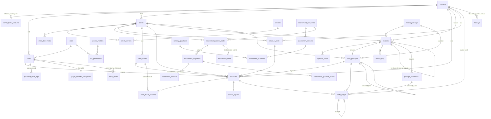

# Skema Database Therapedia — v2

**One Gate Integrated Clinic System** · MySQL 8.0.22+ (InnoDB) · Laravel 12 · Sanctum · **tanpa Redis dan tanpa antrean/queue worker** (cache & session memakai MySQL; semua proses berjalan sinkron di request)

Dokumen ini adalah sumber kebenaran desain database backend. Skema mencakup **seluruh fitur prototype frontend** (`frontend/`): intake & pipeline, mesin asesmen, penjadwalan + kredit, finance, portal terapis, portal orang tua, dashboard, RBAC, dan **jejak perubahan ringan**: kolom `created_by`/`updated_by` di semua modul, `credit_ledger` untuk kredit, dan **`invoice_logs` khusus invoice**. Tidak ada tabel audit log (ADR 0004).

Disusun dengan skill `database-design` (`.claude/skills/database-design/SKILL.md`). Mapping field frontend ↔ kolom ada di bagian 08 dan `docs/guide/03-data-model.md`.

> **Status: FINAL — 4 Okt 2026.** Fitur frontend sudah lengkap dan skema ini sudah diselaraskan dengan kode (`frontend/src/domain`, `docs/guide/`). Siap dijadikan migration (urutan di §09). Keputusan arsitektur: `docs/adr/0001`–`0005`.
> **Diperbarui 11 Okt 2026:** diselaraskan dengan alur frontend final (status invoice hanya `unpaid` → `paid` | `void` dengan Finance "Tandai Lunas", bukti bayar tanpa tolak, cuti = pembatalan `cancelled` kode `OL`) dan ditambah tabel **`assessment_drafts`** (kuesioner 200+ soal bisa dicicil dan dilanjutkan).
> **Diperbarui 13 Okt 2026:** spesifikasi tabel (§04) ditulis ulang dalam bentuk tabel kolom/indeks (bukan kode migration); cakupan cabang akun disederhanakan: `users.branch_id` terisi = 1 cabang, **NULL = semua cabang**, kolom `all_branches` dihapus.
>
> **Aturan final yang paling memengaruhi desain** (rinci di bagian yang ditunjuk):
> 1. **Hapus = permanen dengan cascade** (tanpa soft delete): client, invoice belum lunas, master, cabang; master ber-FK yang pernah dipakai tidak bisa dihapus (§6.7, ADR 0005).
> 2. **Invoice lunas tidak dihapus, di-Void** (alasan wajib; **hanya bila kreditnya belum dipakai**, kredit dipertahankan). Kredit yang sudah berjalan dikembalikan lewat **Refund** (Verified Revenue = lunas − refund, Gross tetap memuat refund). **Invoice pengganti** memakai ulang paket void tanpa kredit dobel (§6.5).
> 3. **Status invoice hanya `unpaid` → `paid` | `void`**: Finance menandai lunas; orang tua tidak mengunggah bukti untuk invoice paket (bukti hanya untuk invoice assessment sebagai syarat membuka kuesioner, tanpa tolak). **Renewal dua jalur**: terbitkan invoice baru, atau langsung lunas (catatan Finance opsional) (§04-F, §6.5).
> 4. **Kredit per paket**: tiap paket membawa **credit leave** (dari master paket); saat cancel admin memilih potong/tidak, dan "potong" memakai credit leave dulu (kredit sesi utuh) baru kredit sesi bila habis; ledger append-only, Frozen = turunan (§04-F, §6.2). **Dua jatah berbeda**: credit leave per paket vs jatah cuti 30 hari/tahun (hanya Finance, §6.8).
> 5. **Saldo lebihan konversi** (`clients.leftover_balance`) memotong invoice paket berikutnya; tab Finance menelusuri sumber & pemakaiannya (Q23).
> 6. **Master Cabang** dikelola Master (`branch_master`); akun terikat 1 cabang bila `users.branch_id` terisi, **`branch_id` NULL = semua cabang** (tanpa flag `all_branches`, §04-A).
> 7. **Semua list dipaginasi 10 data per halaman** (§07); backup harian + arsip tiap 6 bulan/1 tahun (§11).
> 8. **Kuesioner bisa dicicil**: jawaban disimpan sebagai draft (`assessment_drafts`) dan dilanjutkan dengan kode yang sama; hasil final tetap **sekali submit** (§04-D, §6.5b).

---

## Daftar Isi
- [00. Prinsip desain](#00-prinsip-desain)
- [01. Query utama & target performa](#01-query-utama--target-performa)
- [02. Peta modul & tabel](#02-peta-modul--tabel)
- [03. ERD](#03-erd)
- [04. Spesifikasi tabel](#04-spesifikasi-tabel)
- [05. Jejak perubahan](#05-jejak-perubahan-tanpa-audit-log)
- [06. Alur transaksi kritis](#06-alur-transaksi-kritis)
- [07. Strategi performa](#07-strategi-performa)
- [08. Mapping frontend ↔ database & keputusan enum](#08-mapping-frontend--database--keputusan-enum)
- [09. Urutan migration & seeder](#09-urutan-migration--seeder)
- [10. Catatan implementasi Laravel](#10-catatan-implementasi-laravel)
- [11. Job terjadwal (cron) & proses sinkron](#11-job-terjadwal-laravel-scheduler)
- [12. Invarian & checklist implementasi](#12-invarian--checklist-implementasi)

---

## 00. Prinsip desain

| # | Prinsip | Wujud di skema |
|---|---|---|
| 1 | **Indeks dari query, bukan dari kolom** | Setiap indeks komposit di bagian 04 menyebut query yang dilayani (lihat 01) |
| 2 | **Ledger sebagai sumber kebenaran kredit** | `credit_ledger` append-only; saldo di `client_packages` & `clients` adalah denormalisasi yang diperbarui di transaksi yang sama |
| 3 | **Jejak ringan, tanpa audit log** | Semua modul: `created_by`/`updated_by`. Kredit = `credit_ledger` append-only (undo = baris `reversal`), pipeline = status terakhir saja (`clients.status`, `status_changed_at`, `updated_by`; tanpa riwayat tahap), invoice = `invoice_logs` (log milik invoice sendiri, termasuk konversi & pemakaian saldo) |
| 4 | **Reversible by design** | Kolom `previous_status`, `prev_*` (slot sebelum reschedule terakhir), `reverted_at`, `credit_effect`, `reverses_ledger_id`, `client_status_from/to` memungkinkan "completed lalu dibatalkan" tanpa kehilangan jejak |
| 5 | **Aman dari edit bersamaan** | Kolom `version` (optimistic lock) pada entity yang sering diubah → HTTP 409 |
| 6 | **Idempoten** | `credit_ledger.idempotency_key` UNIQUE mencegah potong kredit ganda |
| 7 | **Snapshot nilai transaksi** | Nama paket, harga, nama pelaku disalin saat transaksi agar histori tidak berubah ketika master diedit |
| 8 | **Baca cepat tanpa infrastruktur tambahan** | Dashboard = **VIEW + JOIN** di atas indeks covering & generated column tanggal; tanpa Redis dan tanpa tabel ringkasan selama target terpenuhi (§04-G, §07) |
| 9 | **Lookup table untuk daftar yang bisa diedit** | Layanan dan kuadran = tabel ber-PK `code`. Alasan cancel/discharge juga tabel `code`, tetapi hanya **pilihan cepat tanpa FK** (transaksi menyimpan string, boleh teks custom) |
| 10 | **ENUM untuk siklus hidup tetap** | Status client/sesi/invoice/paket |
| 11 | **Hapus = permanen (hard delete), dikendalikan role** | Punya akses modul = boleh semua aksi termasuk hapus operasional; hapus data penting (client, cabang) hanya role `master`. Data milik (anak) ikut terhapus lewat FK `ON DELETE CASCADE`; master ber-FK yang pernah dipakai diblokir FK `RESTRICT` (ADR 0005, §6.7). Pemulihan hanya dari backup |

Konvensi umum (detail di skill): InnoDB `utf8mb4_0900_ai_ci`; PK `BIGINT UNSIGNED`; waktu `DATETIME` UTC; tanggal kalender `DATE`; slot `TIME`; uang `BIGINT UNSIGNED` rupiah utuh; **tanpa soft delete**: hapus bersifat permanen (`DELETE`) dan menyebar lewat FK `ON DELETE CASCADE` (§6.7); ledger kredit, `invoice_logs`, dan `package_conversions` tidak pernah di-UPDATE oleh aplikasi (hanya ikut terhapus bersama induknya).

---

## 01. Query utama & target performa

Daftar ini adalah dasar desain indeks. Setiap halaman prototype dipetakan ke query utamanya.

| ID | Halaman / fitur | Query | Indeks yang melayani | Target DB p95 |
|---|---|---|---|---|
| Q1 | Weekly Calendar (Admin Schedule) | sesi 1 cabang, 1 minggu, opsional terapis | `schedules (branch_id, session_date, status)` · `schedules (therapist_id, session_date, start_time)` | < 30 ms |
| Q2 | Conflict check saat buat/pindah sesi | sesi aktif terapis X tanggal D yang overlap jam | `schedules (therapist_id, session_date, start_time)` | < 10 ms |
| Q3 | My Schedule (Terapis) | sesi terapis X rentang minggu | `schedules (therapist_id, session_date, start_time)` | < 20 ms |
| Q4 | Inquiry Pipeline (kanban) | client per cabang per status, urut terbaru | `clients (branch_id, status, created_at)` | < 30 ms |
| Q5 | Search client (nama / ortu / kode) | prefix nama anak / nama ortu / kode client | `clients (child_name)`, `clients (parent_name)`, UNIQUE `client_code` | < 30 ms |
| Q6 | Active Clients roster + filter kredit | client `admitted` per cabang + saldo | `clients (branch_id, status, credit_balance)` | < 30 ms |
| Q7 | Birthday radar | client aktif per cabang per bulan lahir | `clients (branch_id, birth_month)` (generated column) | < 20 ms |
| Q8 | Detail client (kredit, sesi, invoice) | by id + relasi | PK + `schedules (client_id, session_date)` · `client_packages (client_id, status)` · `invoices (client_id, issued_at)` | < 30 ms |
| Q9 | Finance — Menunggu Pembayaran | invoice `unpaid` per cabang (+ penanda sudah ada bukti) | `invoices (branch_id, status, issued_at)` | < 20 ms |
| Q10 | Finance — riwayat mutasi kredit | ledger semua client per cabang, terbaru, keyset | `credit_ledger (branch_id, created_at, id)` | < 30 ms |
| Q11 | Revenue dashboard | omzet `paid` per cabang per periode | view `v_daily_revenue` → `invoices idx_inv_paid_date (status, branch_id, paid_date, amount)` | < 50 ms |
| Q12 | Inquiry / Schedule / Branch dashboard | KPI per cabang per periode | view `v_daily_sessions`, `v_daily_credit_usage` (indeks diawali `branch_id, tanggal`); funnel pipeline dihitung live dari `clients` (`idx_clients_pipeline`) + tanggal `date_of_join` / `date_of_discharge` / `date_of_discontinue` | < 50 ms |
| Q13 | Kode kuesioner publik (buka / lanjutkan) | lookup kode, cek `expires_at` & invoice assessment kode itu yang belum ada bukti transfer (`invoices idx_inv_client`), lalu muat draft jawaban bila ada | UNIQUE `assessment_access_codes (code)` · PK `assessment_drafts (access_code_id)` | < 5 ms |
| Q14 | Login ortu | lookup `client_code` + cek `date_of_birth` | UNIQUE `clients (client_code)` | < 5 ms |
| Q17 | Therapist summary | sesi `completed` terapis X per periode + status laporan | `schedules (therapist_id, session_date, start_time)` + `session_reports (schedule_id)` | < 30 ms |
| Q18 | Awaiting questionnaire (+ search nama, + progres draft) | kode `issued` belum submit per cabang; kolom "sedang diisi" = ada baris draft (`answered_count` ÷ jumlah soal kategori) | `assessment_access_codes (status, issued_at)` + join client + LEFT JOIN `assessment_drafts` (PK) | < 30 ms |
| Q19 | Monitoring: sesi completed belum ada report | `completed` per cabang rentang tanggal, `filled_sections = 0` | view `v_unreported_sessions` → `schedules idx_sch_calendar` + `session_reports (schedule_id)` | < 30 ms |
| Q20 | Analitik client periode custom + jadwal rutin/aktif | sesi 1 client rentang tanggal bebas | `schedules (client_id, session_date)`, `schedule_series (client_id, starts_on)` | < 30 ms |
| Q21 | Log satu invoice (tombol Log di tab Billing) | `invoice_logs` per invoice, terbaru dulu | `invoice_logs (invoice_id, created_at, id)` | < 20 ms |
| Q22 | Pencarian tabel keuangan (Verifikasi, Semua Tagihan, Log Buku Besar, tabel transaksi revenue) | prefix nama anak / nama ortu / kode client (via `clients`, Q5) atau nomor invoice; lalu invoice/ledger client hasilnya. Client terhapus sudah hilang beserta datanya (hard delete), tanpa filter tambahan | `clients (child_name)`, `clients (parent_name)`, UNIQUE `client_code` → `invoices (client_id, issued_at)` / `credit_ledger (client_id, created_at)`; nomor invoice: UNIQUE `invoice_number` | < 50 ms |
| Q23 | Finance — tab Saldo Lebihan | client `leftover_balance > 0` (per cabang), lalu `package_conversions` client itu (sumber, join `invoices` asal) dan `invoices.balance_applied > 0` (pemakaian) | `clients idx_clients_leftover (branch_id, leftover_balance)` → `idx_conv_client`, `idx_inv_client` | < 50 ms |
| Q24 | Saldo jatah cuti client (kartu detail client, pratinjau dialog Cuti) + tab Cuti Finance | log cuti `active` client sejak `leave_reset_at` (saldo = `clients.leave_granted` − hari terpakai); tab Cuti: log per cabang terbaru dulu | `client_leaves idx_leave_client (client_id, start_date)`; tab: `idx_leave_branch (branch_id, start_date)` | < 20 ms |
| Q25 | Availability & Utilization Rate per terapis dan cabang (halaman Utilisasi Terapis) + pencari terapis pengganti & Kalender Tim | kapasitas = `users.max_sessions_per_month` disesuaikan filter periode (maks sesi × hari kerja periode ÷ hari kerja bulan; hari kerja = Senin–Sabtu non-`holidays`); terisi = jam sesi terapis di periode berstatus bukan `cancelled`/`reschedule_pending` (1 jam = 1 sesi); dihitung live per terapis lalu diagregasi per cabang. Kalender Tim hari = semua sesi terapis cabang pada satu tanggal; minggu = satu terapis | `schedules idx_sch_therapist (therapist_id, session_date, start_time)` + `holidays` | < 50 ms |
| Q26 | Simpan otomatis & lanjutkan kuesioner (ortu) | simpan: upsert 1 baris per kode (lock baris, cek `version`); lanjutkan: kode → draft | PK `assessment_drafts (access_code_id)` | < 10 ms |
| Q27 | Dashboard Inquiry — Total Discharge + report per alasan | client `discharged` per cabang pada rentang `date_of_discharge`, dikelompokkan `discharge_reason` | `clients idx_clients_discharge (branch_id, date_of_discharge)` | < 30 ms |

Nomor Q15–Q16 tidak dipakai (query lama dihapus bersama audit log); nomor tidak diurutkan ulang agar referensi di dokumen lain tetap valid.

Target API (server, p95): detail < 100 ms · list < 200 ms · aksi transaksional < 150 ms · dashboard < 100 ms.

---

## 02. Peta modul & tabel

| Modul | Tabel | Fungsi singkat |
|---|---|---|
| **A. Organisasi & akses** | `branches` | Cabang klinik |
| | `branch_bank_accounts` | Rekening bank pembayaran per cabang (1 cabang : N rekening; tampil ke ortu sebagai info transfer) |
| | `roles` | Role sistem & kustom |
| | `access_modules` | Daftar modul RBAC |
| | `role_permissions` | Matriks role × modul |
| | `users` | Staf internal + terapis (satu tabel) |
| | `password_reset_otps` | OTP email untuk lupa password staf |
| **B. Master data** | `services` | Layanan intake (BOT-A, FOT-A, Consultation, …) |
| | `sensory_quadrants` | Kuadran sensori (AV/SN/RG/SK) |
| | `cancel_reasons` | Pilihan cepat alasan **Cancel / Off** (satu tabel; tanpa FK; transaksi menyimpan string). `is_therapist_off = 1` menandai alasan **Therapist Off** (master terpisah di UI; dasar Therapist Off Rate) |
| | `discharge_reasons` | Pilihan cepat alasan discharge (tanpa FK; transaksi menyimpan string) |
| | `master_packages` | Katalog paket kredit (+ jatah cuti, `is_satuan`, `is_assessment`) |
| | `holidays` | Hari libur (dilewati jadwal berulang, tak bisa dipilih di kalender) |
| **C. Client & intake** | `clients` | Master anak (kode client = login portal ortu) |
| | `client_code_counters` | Counter kode client per grup huruf (AE/FJ/KO/PT/UZ) |
| | `client_services` | Layanan dipilih (multi) |
| | `client_documents` | Tautan GDrive / dokumen |
| **D. Asesmen** | `assessment_categories` | Instrumen (Sensory Profile 2, …) |
| | `assessment_sections` | Bagian/domain soal |
| | `assessment_questions` | Bank soal (12 tipe) |
| | `assessment_access_codes` | Kode kuesioner publik |
| | `assessment_drafts` | Draft jawaban kuesioner (simpan otomatis / lanjutkan; dihapus saat submit) |
| | `assessment_responses` | Pengisian kuesioner (sekali isi) |
| | `assessment_answers` | Jawaban per soal |
| | `assessment_quadrant_scores` | Skor kuadran per pengisian |
| **E. Penjadwalan** | `schedule_series` | Pola jadwal berulang |
| | `client_leaves` | Log cuti client (rentang penampung; hari dihitung sesi pertama–terakhir memotong saldo `clients.leave_granted`; dicatat Finance) |
| | `client_leave_sessions` | Sesi yang dibatalkan oleh satu log cuti (untuk tombol Detail) |
| | `leave_resets` | Riwayat Reset Cuti Tahunan |
| | `schedules` | Sesi terapi/asesmen |
| | `session_reports` | Laporan sesi 3 bagian |
| | `google_calendar_integrations` | *(fase terakhir)* Token & kalender Google per user |
| **F. Keuangan & kredit** | `invoices` | Tagihan (paket sesi / assessment) |
| | `invoice_counters` | Counter nomor invoice per kode + tanggal |
| | `payment_proofs` | Bukti transfer (riwayat upload) |
| | `client_packages` | Paket kredit milik client |
| | `credit_ledger` | Mutasi kredit append-only |
| | `package_conversions` | Konversi sisa sesi paket ke paket lain (Finance) |
| | `invoice_logs` | Log milik invoice sendiri (append-only) |
| **G. Analitik** | *view* `v_daily_revenue`, `v_daily_sessions`, `v_daily_credit_usage`, `v_therapist_sessions`, `v_invoice_queue`, `v_unreported_sessions` | Dashboard & list gabungan (bukan tabel, tidak menyimpan data) |
| **H. Laravel bawaan** | `personal_access_tokens`, `sessions`, `cache`, `cache_locks`, `jobs`, `failed_jobs`, `job_batches` | Sanctum, session, cache driver `database` (MySQL). Tabel `jobs`/`failed_jobs`/`job_batches` **tetap dibuat** (migration bawaan Laravel tidak diubah) tetapi tidak dipakai karena tidak ada queue worker (`QUEUE_CONNECTION=sync`) |

Total: 38 tabel domain (+1 tabel fase terakhir: `google_calendar_integrations`) + 6 view + tabel bawaan Laravel.

---

## 03. ERD



Garis = foreign key. **Aturan hapus tiap FK** (CASCADE / RESTRICT / SET NULL) ada di spesifikasi tabel (§04) dan matriks hapus (§6.7).

---

## 04. Spesifikasi tabel

Setiap tabel ditulis sebagai tabel kolom + tabel indeks. Cara baca:

| Singkatan | Arti |
|---|---|
| **PK** / **UQ** | Primary key / unique |
| **FK → tabel · X** | Foreign key; X = aturan `ON DELETE` (`CASCADE` anak ikut terhapus, `RESTRICT` hapus induk ditolak, `SET NULL` kolom jadi NULL) |
| **BIGINT U** | `BIGINT UNSIGNED` (semua PK `id` & FK ke `id`) |
| **Gen** | Generated column (`STORED`), tidak diisi aplikasi |
| `created_by` / `updated_by` | FK → `users` · `SET NULL`; pelaku pembuat / editor terakhir (§05) |
| `// Qn` | Query di §01 yang dilayani indeks tersebut |

Semua tabel InnoDB `utf8mb4_0900_ai_ci`. `timestamps` = `created_at` + `updated_at` (`TIMESTAMP`, NULL).

### A. Organisasi & akses

#### `branches`
Dikelola Master lewat menu **Master Cabang** (modul akses `branch_master`, `POST/PUT /branches`, `PATCH /branches/{id}/active`). Cabang yang tak lagi beroperasi dinonaktifkan (`is_active = 0`): tidak muncul di pilihan penugasan/intake baru, riwayat dan nama tetap tampil. **Hapus** (permanen, hanya role `master`) menghapus **seluruh data cabang**: client beserta semua datanya, jadwal, invoice, ledger, hari libur cabang, dan akun staf/terapis yang terikat cabang itu (alur di §6.7; sinkron dalam satu transaksi atomik dengan konfirmasi mengetik kode cabang). `code` dan `name` unik (divalidasi service; `code` 2–10 huruf/angka).

| Kolom | Tipe | Null | Default | Keterangan |
|---|---|---|---|---|
| `id` | BIGINT U | — | auto | PK |
| `code` | VARCHAR(20) | — | — | UQ. Mis. `EAST`, `CTL`, `WEST` |
| `name` | VARCHAR(100) | — | — | UQ. Mis. East, Citraland, West |
| `city` | VARCHAR(50) | — | `Surabaya` | |
| `address` | TEXT | ✔ | | |
| `phone` | VARCHAR(30) | ✔ | | |
| `is_active` | BOOLEAN | — | 1 | |
| `updated_by` | BIGINT U | ✔ | | FK → `users` ditambahkan di migration terpisah setelah `users` dibuat (tabel ini dibuat lebih awal) |
| `created_at`, `updated_at` | TIMESTAMP | ✔ | | |

#### `branch_bank_accounts`
Rekening bank pembayaran milik cabang, dikelola lewat **Master Cabang** (modul `branch_master`; dialog "Rekening" per cabang). Satu cabang boleh punya beberapa rekening. Rekening **aktif** cabang tempat client di-intake ditampilkan ke ortu sebagai info transfer: di kuesioner publik (tahap upload bukti transfer, juga pada respons 403 `proof_required`) dan di portal ortu. Rekening nonaktif disembunyikan dari ortu tetapi tetap tersimpan. Hapus rekening = `DELETE` permanen (tidak ada FK lain yang memakainya); hapus cabang menghapus rekeningnya (CASCADE). Tanpa `version` (konsisten dengan `branches`).

| Kolom | Tipe | Null | Default | Keterangan |
|---|---|---|---|---|
| `id` | BIGINT U | — | auto | PK |
| `branch_id` | BIGINT U | — | — | FK → `branches` **CASCADE** |
| `bank_name` | VARCHAR(100) | — | — | Mis. BCA, Mandiri |
| `account_number` | VARCHAR(50) | — | — | String (jaga angka 0 di depan); hanya angka/spasi/strip |
| `account_holder` | VARCHAR(150) | — | — | Atas nama |
| `is_active` | BOOLEAN | — | 1 | Nonaktif tidak tampil ke ortu |
| `sort_order` | SMALLINT U | — | 0 | Urutan tampil; rekening baru otomatis di akhir |
| `created_by`, `updated_by` | BIGINT U | ✔ | | FK → `users` SET NULL |
| `created_at`, `updated_at` | TIMESTAMP | ✔ | | |

Indeks: `UNIQUE (branch_id, bank_name, account_number)` (cegah rekening ganda per cabang); `(branch_id, is_active, sort_order)` melayani query daftar rekening aktif per cabang untuk ortu dan `GET /branches` (eager load).

#### `roles`
Role sistem (`master`, `manager`, `admin_inquiry`, `admin_schedule`, `finance`, `therapist`) + role kustom buatan Master. Orang tua **tidak** memakai tabel ini (auth via `clients`).

| Kolom | Tipe | Null | Default | Keterangan |
|---|---|---|---|---|
| `id` | BIGINT U | — | auto | PK |
| `code` | VARCHAR(50) | — | — | UQ. `master`, `admin_inquiry`, `custom_xxx` |
| `name` | VARCHAR(100) | — | — | |
| `badge` | VARCHAR(100) | ✔ | | |
| `description` | TEXT | ✔ | | |
| `is_system` | BOOLEAN | — | 0 | Role sistem tidak bisa dihapus |
| `updated_by` | BIGINT U | ✔ | | FK → `users` · SET NULL |
| `created_at`, `updated_at` | TIMESTAMP | ✔ | | |

#### `access_modules`

| Kolom | Tipe | Null | Default | Keterangan |
|---|---|---|---|---|
| `code` | VARCHAR(50) | — | — | **PK**. `revenue`, `inquiry_pipeline`, `weekly_calendar`, `finance`, `rbac`, `unreported_reports` (monitoring report), `holidays`, `branch_master`, … |
| `label` | VARCHAR(100) | — | — | |
| `category` | VARCHAR(50) | — | — | Financial, Inquiry, Scheduling, Administration, Clinical |
| `description` | TEXT | ✔ | | |
| `sort_order` | SMALLINT U | — | 0 | |

#### `role_permissions`

| Kolom | Tipe | Null | Default | Keterangan |
|---|---|---|---|---|
| `role_id` | BIGINT U | — | — | PK (1/2). FK → `roles` · CASCADE |
| `module_code` | VARCHAR(50) | — | — | PK (2/2). FK → `access_modules.code` · CASCADE (update juga CASCADE) |
| `allowed` | BOOLEAN | — | 0 | |
| `created_at`, `updated_at` | TIMESTAMP | ✔ | | |

Dibaca setiap request (policy): satu query by PK `role_id` (±12 baris), cukup **dimemo per request** di `PermissionService`. Opsional: cache driver `database` (`Cache::remember("rbac:role:{id}")`, tabel `cache` MySQL) dengan invalidasi saat matriks diubah. Tidak butuh Redis.

**Aturan akses (keputusan klien):** `allowed = true` pada suatu modul = role boleh **semua aksi** di modul itu (lihat, tambah, ubah, ubah status), termasuk Manager (tidak lagi read-only). Hapus dibagi dua (13 Okt 2026): **data penting** (client inquiry/aktif dan cabang, yang ikut menghapus seluruh data turunannya) **hanya role `master`**; **hapus operasional** (invoice belum lunas, sesi, jadwal rutin, hari libur, master data, kode kuesioner) cukup akses modul terkait. Tidak ada kolom/flag `can_delete` di `roles`. Void invoice, renewal langsung, dan koreksi saldo kredit = aksi modul `finance` (tanpa daftar role hardcode).

#### `users`
Staf internal & terapis dalam satu tabel. Atribut klinis nullable untuk non-terapis.

**Aturan cabang (11 Okt 2026):** cakupan cabang akun ditentukan **hanya oleh `branch_id`**, tanpa flag tambahan:

| `branch_id` | Artinya |
|---|---|
| **terisi** | Akun terikat **1 cabang** itu (data, kalender, dan pilihan cabang dibatasi ke sana) |
| **NULL** | Akun berlaku untuk **semua cabang** |

Berlaku untuk semua role (termasuk terapis dan role kustom); Master yang mengaturnya di User Management. Tidak ada kolom `all_branches`.

| Kolom | Tipe | Null | Default | Keterangan |
|---|---|---|---|---|
| `id` | BIGINT U | — | auto | PK |
| `role_id` | BIGINT U | — | — | FK → `roles` · RESTRICT |
| `branch_id` | BIGINT U | ✔ | | FK → `branches` · **RESTRICT** (jangan `SET NULL`: staf akan berubah jadi "semua cabang"; dihapus eksplisit oleh hapus cabang, §6.7). **NULL = semua cabang** |
| `name` | VARCHAR(150) | — | — | |
| `email` | VARCHAR(150) | — | — | UQ |
| `password` | VARCHAR(255) | — | — | Hash |
| `must_change_password` | BOOLEAN | — | 1 | 1 bila password diatur/di-reset Master → wajib ganti saat login berikutnya |
| `password_changed_at` | TIMESTAMP | ✔ | | |
| `phone` | VARCHAR(30) | ✔ | | |
| `title` | VARCHAR(50) | ✔ | | S.Tr.Kes, S.Ft, A.Md.OT |
| `specialty` | VARCHAR(150) | ✔ | | |
| `max_sessions_per_month` | SMALLINT U | ✔ | NULL (= bawaan 100) | TERAPIS: maks sesi per bulan = total jam kerja sebulan (1 sesi = 1 jam), diisi di Utilisasi Terapis; penyebut Availability/Utilization (Q25). CHECK 1..744; tidak memblokir penjadwalan |
| `is_active` | BOOLEAN | — | 1 | Staf berhenti dinonaktifkan; data & riwayat sesi tetap. Staf hanya terhapus lewat hapus cabang (§6.7) |
| `last_login_at` | TIMESTAMP | ✔ | | |
| `remember_token` | VARCHAR(100) | ✔ | | |
| `created_by`, `updated_by` | BIGINT U | ✔ | | FK → `users` · SET NULL |
| `created_at`, `updated_at` | TIMESTAMP | ✔ | | |

| Indeks | Kolom | Melayani |
|---|---|---|
| `idx_users_branch_role` | `branch_id, role_id, is_active` | Daftar staf/terapis per cabang |

Catatan akun:
- **Password awal / reset oleh Master**: Master mengisi password sementara → `must_change_password = 1`; setelah login pertama user wajib menggantinya (`password_changed_at` terisi, flag 0).
- **Lupa password** (staf): minta OTP via email → baris `password_reset_otps` → verifikasi OTP → set password baru. Master juga bisa mereset langsung dari User Management (password sementara + `must_change_password = 1`, tanpa OTP).
- **Daftar terapis per cabang**: akun terapis ber-`branch_id` NULL muncul di pilihan terapis **semua cabang**; filter `WHERE branch_id = :cabang OR branch_id IS NULL`.

#### `password_reset_otps`

| Kolom | Tipe | Null | Default | Keterangan |
|---|---|---|---|---|
| `id` | BIGINT U | — | auto | PK |
| `user_id` | BIGINT U | — | — | FK → `users` · CASCADE |
| `otp_hash` | VARCHAR(255) | — | — | Hash OTP 6 digit (tidak disimpan polos) |
| `expires_at` | TIMESTAMP | — | — | Mis. 10 menit |
| `attempts` | TINYINT U | — | 0 | Maks 5 salah → OTP hangus |
| `used_at` | TIMESTAMP | ✔ | | |
| `requested_ip` | VARCHAR(45) | ✔ | | |
| `created_at` | TIMESTAMP | — | now | |

| Indeks | Kolom | Melayani |
|---|---|---|
| `idx_otp_user` | `user_id, created_at` | Cek OTP terakhir per user |

Throttle permintaan OTP per email & per IP (RateLimiter). Baris kedaluwarsa dibersihkan housekeeping (§11).

### B. Master data

Tabel master kecil (puluhan baris) dan dibaca lewat PK → query langsung < 1 ms dari buffer pool InnoDB. Frontend memuatnya sekali per sesi (react-query `staleTime` panjang). Tidak perlu Redis.

#### `services`

| Kolom | Tipe | Null | Default | Keterangan |
|---|---|---|---|---|
| `code` | VARCHAR(50) | — | — | **PK**. `b_ota`, `f_ota`, `school_companion`, `consult_wo_report`, `consult_w_report` |
| `label` | VARCHAR(150) | — | — | |
| `category` | VARCHAR(50) | — | — | String bebas (tanpa enum): combo box UI menawarkan Asesmen / Konsultasi / Terapi + opsi ketik kategori sendiri |
| `description` | TEXT | ✔ | | |
| `is_active` | BOOLEAN | — | 1 | Nonaktif = tidak bisa dipilih, label tetap tampil |
| `sort_order` | SMALLINT U | — | 0 | |
| `updated_by` | BIGINT U | ✔ | | FK → `users` · SET NULL |
| `created_at`, `updated_at` | TIMESTAMP | ✔ | | |

#### `sensory_quadrants`

| Kolom | Tipe | Null | Default | Keterangan |
|---|---|---|---|---|
| `code` | VARCHAR(10) | — | — | **PK**. `AV`, `SN`, `RG`, `SK` |
| `title` | VARCHAR(60) | — | — | |
| `full_name` | VARCHAR(100) | — | — | |
| `description` | TEXT | ✔ | | |
| `color` | VARCHAR(20) | — | `slate` | |
| `sort_order` | SMALLINT U | — | 0 | |
| `updated_by` | BIGINT U | ✔ | | FK → `users` · SET NULL |
| `created_at`, `updated_at` | TIMESTAMP | ✔ | | |

#### `cancel_reasons` & `discharge_reasons` (pilihan cepat, TANPA foreign key)
Hanya **sumber pilihan cepat** untuk dropdown di UI (dikelola di menu Master Data). Tabel transaksi (`schedules`, `clients`, `credit_ledger`) menyimpan alasan sebagai **string biasa** (`cancel_reason`, `pending_reason`, `discharge_reason`): berisi `code` pilihan cepat **atau** teks bebas yang diketik user ("Lainnya"). Karena itu tidak ada FK: mengubah/menghapus pilihan tidak memengaruhi riwayat, dan teks bebas tidak perlu terdaftar. Label tampil = `label` bila string cocok dengan `code`, selain itu string apa adanya.

**Therapist Off (10 Okt 2026)**: alasan karena terapis berhalangan disimpan di tabel yang sama dengan `is_therapist_off = 1` (UI: tab *Therapist Off* di Master Data; `code` unik lintas kedua daftar karena PK sama; tetap menjadi pilihan di form Cancel / Off). Sesi tidak mendapat kolom baru: statistik mengenali Therapist Off lewat `schedules.cancel_reason = cancel_reasons.code AND is_therapist_off = 1`. Cancel Therapist Off **tetap terhitung di Cancellation Rate keseluruhan**; Therapist Off Rate hanya rinciannya (keduanya dibagi total sesi pada filter). Karena tanpa FK, menghapus alasan atau mengubah flag-nya mengubah klasifikasi riwayat lama (konsisten dengan frontend); nonaktifkan bila ingin hitungan lama tetap.

Kuota cancel 3x per paket **sudah diganti credit leave per paket** (`client_packages.leave_total/leave_used`, §6.2); `cancel_count` tinggal penghitung statistik. Alasan sistem `reschedule_dibatalkan` (drop reschedule menggantung, netral kredit) adalah konstanta kode, bukan baris tabel.

**`cancel_reasons`**

| Kolom | Tipe | Null | Default | Keterangan |
|---|---|---|---|---|
| `code` | VARCHAR(40) | — | — | **PK**. SATU daftar Cancel / Off (revisi 7 Okt 2026): `sakit`, `izin_keluarga`, `bentrok_sekolah`, `tanpa_kabar`, `OL`, `S`, `SCA`, `MCU`, `FM`, `TI`, `H` |
| `label` | VARCHAR(120) | — | — | |
| `is_active` | BOOLEAN | — | 1 | Nonaktif = tidak muncul di pilihan baru |
| `is_therapist_off` | BOOLEAN | — | 0 | Master Therapist Off (seed: `TO`, `TS`): dasar Therapist Off Rate; tetap muncul di pilihan Cancel / Off |
| `sort_order` | SMALLINT U | — | 0 | |
| `updated_by` | BIGINT U | ✔ | | FK → `users` · SET NULL |
| `created_at`, `updated_at` | TIMESTAMP | ✔ | | |

**`discharge_reasons`**

| Kolom | Tipe | Null | Default | Keterangan |
|---|---|---|---|---|
| `code` | VARCHAR(40) | — | — | **PK**. `moving`, `financial`, `conflict_schedule`, `expectation_not_met`, `graduate` |
| `label` | VARCHAR(120) | — | — | |
| `is_active` | BOOLEAN | — | 1 | |
| `sort_order` | SMALLINT U | — | 0 | |
| `updated_by` | BIGINT U | ✔ | | FK → `users` · SET NULL |
| `created_at`, `updated_at` | TIMESTAMP | ✔ | | |

#### `master_packages`

| Kolom | Tipe | Null | Default | Keterangan |
|---|---|---|---|---|
| `id` | BIGINT U | — | auto | PK |
| `code` | VARCHAR(50) | — | — | UQ. `pkg-reguler`, `pkg-vip`, `pkg-consult` |
| `invoice_code` | VARCHAR(10) | — | — | UQ. Kode pendek untuk nomor invoice (mis. `REG`, `VIP`); `ASM` dicadangkan untuk invoice assessment |
| `name` | VARCHAR(150) | — | — | |
| `credits` | SMALLINT U | — | — | Jumlah sesi |
| `price` | BIGINT U | — | — | Rupiah |
| `description` | TEXT | ✔ | | |
| `leave_quota` | SMALLINT U | — | 3 | **Credit leave per paket** (sesi): pembatalan yang ditanggung per paket. Saat Cancel/Off pilihan "potong", credit leave dipakai dulu (kredit sesi utuh); habis → kredit sesi dipotong. Di-snapshot ke `client_packages.leave_total` saat paket dibeli. BUKAN jatah cuti 30 hari/tahun |
| `is_satuan` | BOOLEAN | — | 0 | Paket satuan (per sesi): cuti maks 1x per bulan kalender; jatah TIDAK reset otomatis saat renewal (Finance memakai opsi reset) |
| `is_assessment` | BOOLEAN | — | 0 | Hanya paket berflag ini yang jadi pilihan layanan saat menerbitkan kode asesmen / re-assessment |
| `is_active` | BOOLEAN | — | 1 | |
| `updated_by` | BIGINT U | ✔ | | FK → `users` · SET NULL |
| `created_at`, `updated_at` | TIMESTAMP | ✔ | | |

#### `holidays`
Tanggal libur (nasional / klinik). Jadwal berulang **melewati** tanggal ini (tidak dibuatkan sesi) dan kalender tidak bisa memilihnya (422 saat buat/pindah sesi). Menambah libur **tidak** mengubah sesi yang sudah ada (UI memberi penanda). Hapus = hard delete (data konfigurasi, tanpa riwayat).

| Kolom | Tipe | Null | Default | Keterangan |
|---|---|---|---|---|
| `id` | BIGINT U | — | auto | PK |
| `branch_id` | BIGINT U | ✔ | | FK → `branches` · CASCADE. **NULL = semua cabang** (sama dengan aturan `users.branch_id`) |
| `branch_key` | BIGINT U | — | Gen | `IFNULL(branch_id, 0)`; dipakai agar UNIQUE bekerja untuk NULL |
| `holiday_date` | DATE | — | — | |
| `name` | VARCHAR(150) | — | — | Hari Kemerdekaan RI |
| `created_by`, `updated_by` | BIGINT U | ✔ | | FK → `users` · SET NULL |
| `created_at`, `updated_at` | TIMESTAMP | ✔ | | |

| Indeks | Kolom | Melayani |
|---|---|---|
| `uq_holidays_date_branch` | UNIQUE `holiday_date, branch_key` | Satu libur per tanggal per cabang (atau satu libur "semua cabang") |

### C. Client & intake

#### `clients`
Master anak, entity pipeline, **sekaligus entity login portal ortu** (`client_code` + tanggal lahir anak). 1 client = 1 orang tua yang didaftarkan.

| Kolom | Tipe | Null | Default | Keterangan |
|---|---|---|---|---|
| `id` | BIGINT U | — | auto | PK |
| `client_code` | VARCHAR(10) | — | — | UQ (Q14). `AE-00001`: grup 2 huruf (dari huruf pertama nama) + 5 digit counter per grup (`client_code_counters`). ID rekam medis SEKALIGUS kode login ortu; tidak berubah walau nama diedit |
| `branch_id` | BIGINT U | — | — | FK → `branches` · CASCADE (hapus cabang = hapus seluruh client cabang itu, §6.7). **Selalu terisi**: client milik tepat 1 cabang |
| **Biodata** | | | | |
| `child_name` | VARCHAR(120) | — | — | Nama lengkap (tanpa nama panggilan) |
| `gender` | ENUM | — | — | `male`, `female` |
| `date_of_birth` | DATE | — | — | |
| `birth_month` | TINYINT U | — | Gen | `MONTH(date_of_birth)` — Q7 birthday radar |
| `parent_name` | VARCHAR(120) | — | — | |
| `parent_phone` | VARCHAR(30) | — | — | WhatsApp |
| `parent_email` | VARCHAR(150) | ✔ | | |
| `address` | TEXT | ✔ | | |
| `intake_note` | TEXT | ✔ | | Catatan saat intake (keluhan utama, rujukan, dll). Laporan asesmen memakai `session_reports`, bukan kolom ini |
| **Pipeline & outcome** | | | | |
| `status` | ENUM | — | `inquiry` | `inquiry`, `service_selected`, `assessment_scheduled`, `assessment_done`, `admitted`, `done_consult`, `done_assessment`, `discontinued`, `discharged` |
| `final_outcome` | ENUM | ✔ | | `admitted`, `done_consult`, `done_assessment`, `discontinued` |
| `status_changed_at` | TIMESTAMP | ✔ | | |
| `date_of_join` | DATE | ✔ | | Diisi saat admit pertama |
| `date_of_discharge` | DATE | ✔ | | |
| `date_of_discontinue` | DATE | ✔ | | Terpisah dari discharge |
| `discharge_reason` | VARCHAR(150) | ✔ | | String bebas: code pilihan cepat atau teks custom (tanpa FK); dipakai juga untuk alasan discontinue |
| `discharge_note` | TEXT | ✔ | | |
| **Denormalisasi kredit** (sumber kebenaran: `credit_ledger`; diperbarui di transaksi yang sama) | | | | |
| `credit_balance` | INT | — | 0 | Σ `remaining_credit` paket aktif; 0 = Frozen |
| `leave_granted` | SMALLINT U | — | 30 | **Jatah cuti (hari)** sejak `leave_reset_at`: 30 hari/tahun per client, HANYA diubah Finance (Reset Cuti Tahunan, §6.8 butir 5: sisa HANGUS). Tidak terkait credit leave paket. Sisa = `leave_granted` − hari terpakai (turunan dari `client_leaves`, tidak disimpan) |
| `leave_credit_balance` | SMALLINT U | — | 0 | Total **credit leave** client = Σ (`leave_total` − `leave_used`) paket `active`/`depleted`; diperbarui di transaksi yang sama dengan mutasi credit leave; dicek `credits:reconcile` |
| `leave_reset_at` | DATE | ✔ | | Tanggal reset cuti terakhir; pemakaian sebelum tanggal ini tidak dihitung lagi |
| `leftover_balance` | BIGINT U | — | 0 | **Rupiah**: saldo lebihan konversi paket, memotong invoice paket berikutnya. = Σ `package_conversions.leftover_amount` − Σ `invoices.balance_applied` dari invoice yang masih berlaku (invoice terhapus atau void `revoke` tidak dihitung karena saldonya sudah kembali; void `keep` tetap dihitung) |
| **Portal ortu** | | | | |
| `last_login_at` | TIMESTAMP | ✔ | | Login = `client_code` + `date_of_birth` (Q14) |
| `version` | INT U | — | 1 | Optimistic lock |
| `created_by`, `updated_by` | BIGINT U | ✔ | | FK → `users` · SET NULL |
| `created_at`, `updated_at` | TIMESTAMP | ✔ | | |

| Indeks | Kolom | Melayani |
|---|---|---|
| `idx_clients_pipeline` | `branch_id, status, created_at` | Q4 |
| `idx_clients_roster` | `branch_id, status, credit_balance` | Q6 |
| `idx_clients_birthday` | `branch_id, birth_month` | Q7 |
| `idx_clients_leftover` | `branch_id, leftover_balance` | Q23 tab Saldo Lebihan |
| `idx_clients_discharge` | `branch_id, date_of_discharge` | Q27 Total Discharge + report per alasan |
| `idx_clients_child_name` | `child_name` | Q5 prefix search |
| `idx_clients_parent_name` | `parent_name` | Q5 |

Catatan:
- **Frozen** tidak disimpan sebagai status; diturunkan dari `credit_balance = 0` (sesuai frontend).
- Search nama memakai prefix (`LIKE 'abc%'`). Jika butuh search di tengah kata, tambahkan `FULLTEXT(child_name, parent_name)` (ngram parser). Pencarian client: awal nama anak, nama ortu, atau kode client (prefix).
- Login ortu: `client_code` **+ tanggal lahir anak** (`date_of_birth`) sebagai verifikasi kedua (tanpa PIN). Respons gagal selalu generik (tidak membocorkan mana yang salah). `client_code` **berurutan** (AE-00001, AE-00002, …) sehingga mudah ditebak: tanggal lahir adalah satu-satunya faktor kedua, jadi wajib throttle per IP & per kode + lockout sementara (Laravel RateLimiter). Client yang sudah dihapus tidak bisa login (barisnya sudah tidak ada). Kode tidak diberikan ulang/diganti sendiri oleh ortu: admin yang menginformasikan kode (D5).
- **Status**: perpindahan otomatis (assessment dijadwalkan, sesi asesmen completed; **kuesioner terisi TIDAK mengubah status**) hanya maju; perubahan **manual** (outcome, discharge, reaktivasi) boleh ke tahap mana pun, menimpa `status`, `status_changed_at`, dan `updated_by` (§6.6; tanpa riwayat tahap). Client discharge/discontinued dapat diaktifkan kembali (`admitted`) dari list maupun detail.
- Nama anak hanya satu kolom `child_name`. Layanan pendamping sekolah = layanan `school_companion` di `client_services`, bukan flag di `clients`.

#### `client_code_counters`
Counter kode client per grup huruf. Grup ditentukan dari huruf pertama nama: A–E = `AE`, F–J = `FJ`, K–O = `KO`, P–T = `PT`, U–Z = `UZ`. Nomor = counter grup + 1 (global lintas cabang), tampil 5 digit (`AE-00001`). Dinaikkan di transaksi pembuatan client: `UPDATE client_code_counters SET last_number = LAST_INSERT_ID(last_number + 1) WHERE group_code = ?` (atomik).

| Kolom | Tipe | Null | Default | Keterangan |
|---|---|---|---|---|
| `group_code` | CHAR(2) | — | — | **PK**. `AE`, `FJ`, `KO`, `PT`, `UZ` (di-seed) |
| `last_number` | INT U | — | 0 | |

#### `client_services`

| Kolom | Tipe | Null | Default | Keterangan |
|---|---|---|---|---|
| `client_id` | BIGINT U | — | — | PK (1/2). FK → `clients` · CASCADE |
| `service_code` | VARCHAR(50) | — | — | PK (2/2). FK → `services.code` · RESTRICT |
| `selected_at` | TIMESTAMP | — | now | |
| `selected_by` | BIGINT U | ✔ | | FK → `users` · SET NULL |

| Indeks | Kolom | Melayani |
|---|---|---|
| `idx_client_services_service` | `service_code` | Funnel per layanan |

#### `client_documents`

| Kolom | Tipe | Null | Default | Keterangan |
|---|---|---|---|---|
| `id` | BIGINT U | — | auto | PK |
| `client_id` | BIGINT U | — | — | FK → `clients` · CASCADE |
| `type` | ENUM | — | `gdrive_folder` | `gdrive_folder`, `referral`, `observation_video`, `report`, `other` |
| `label` | VARCHAR(150) | ✔ | | |
| `url` | VARCHAR(500) | — | — | |
| `created_by`, `updated_by` | BIGINT U | ✔ | | FK → `users` · SET NULL |
| `created_at`, `updated_at` | TIMESTAMP | ✔ | | |

| Indeks | Kolom | Melayani |
|---|---|---|
| `idx_client_docs_client` | `client_id, type` | Dokumen per client |

### D. Mesin asesmen

#### `assessment_categories`

| Kolom | Tipe | Null | Default | Keterangan |
|---|---|---|---|---|
| `id` | BIGINT U | — | auto | PK |
| `type_code` | VARCHAR(10) | — | — | UQ. Kode jenis asesmen = prefix kode kuesioner (mis. `SP2`, `SC`); jangan diubah setelah ada kode terbit |
| `name` | VARCHAR(200) | — | — | Child Sensory Profile 2 (Winnie Dunn…) |
| `domain` | VARCHAR(150) | ✔ | | |
| `is_active` | BOOLEAN | — | 1 | |
| `version` | INT U | — | 1 | |
| `updated_by` | BIGINT U | ✔ | | FK → `users` · SET NULL |
| `created_at`, `updated_at` | TIMESTAMP | ✔ | | |

#### `assessment_sections`

| Kolom | Tipe | Null | Default | Keterangan |
|---|---|---|---|---|
| `id` | BIGINT U | — | auto | PK |
| `category_id` | BIGINT U | — | — | FK → `assessment_categories` · CASCADE |
| `title` | VARCHAR(150) | — | — | Pemrosesan AUDITORI |
| `description` | TEXT | ✔ | | Teks panduan section, pendek atau panjang, multi-baris (mis. "Anakku ...", kunci skala 0–5, pengantar kesepakatan). Menggantikan `lead_text` VARCHAR(150) — migration: rename + lebarkan ke TEXT (13 Okt skeleton belum dipakai produksi) |
| `document_url` | VARCHAR(500) | ✔ | | Link Google Docs/Drive yang ditampilkan ke ortu lewat iframe (mis. kesepakatan asesmen). Validasi: https + host `docs.google.com` / `drive.google.com` (frontend `toDocumentEmbedUrl`); dokumen harus dibagikan "Siapa saja yang memiliki link". Persetujuan = soal `multiple_choice` satu opsi, bukan kolom khusus |
| `sort_order` | SMALLINT U | — | 0 | |
| `updated_by` | BIGINT U | ✔ | | FK → `users` · SET NULL |
| `created_at`, `updated_at` | TIMESTAMP | ✔ | | |

| Indeks | Kolom | Melayani |
|---|---|---|
| `idx_sections_category` | `category_id, sort_order` | Render form |

#### `assessment_questions`

| Kolom | Tipe | Null | Default | Keterangan |
|---|---|---|---|---|
| `id` | BIGINT U | — | auto | PK |
| `category_id` | BIGINT U | — | — | FK → `assessment_categories` · CASCADE. Denormalisasi agar form dimuat 1 query |
| `section_id` | BIGINT U | — | — | FK → `assessment_sections` · CASCADE |
| `item_no` | SMALLINT U | — | — | |
| `quadrant_code` | VARCHAR(10) | ✔ | | FK → `sensory_quadrants.code` · RESTRICT |
| `question_type` | ENUM | — | `scale_0_5` | `scale_0_5`, `range`, `multiple_choice`, `checkbox_multi`, `free_text`, `yes_no`, `short_text`, `number`, `dropdown`, `date`, `birth_date`, `time` |
| `question` | TEXT | — | — | |
| `options` | JSON | ✔ | | Pilihan untuk `multiple_choice` / `checkbox_multi` / `dropdown` |
| `range_min`, `range_max` | SMALLINT | ✔ | | |
| `range_min_label`, `range_max_label` | VARCHAR(60) | ✔ | | |
| `is_required` | BOOLEAN | — | 1 | Soal opsional = 0 (boleh kosong saat kirim; tidak menahan progres 100%). Frontend: `question.required` (default true) |
| `sort_order` | SMALLINT U | — | 0 | |
| `updated_by` | BIGINT U | ✔ | | FK → `users` · SET NULL |
| `created_at`, `updated_at` | TIMESTAMP | ✔ | | |

| Indeks | Kolom | Melayani |
|---|---|---|
| `idx_questions_form` | `category_id, section_id, sort_order` | Render form |

#### `assessment_access_codes`

| Kolom | Tipe | Null | Default | Keterangan |
|---|---|---|---|---|
| `id` | BIGINT U | — | auto | PK |
| `code` | VARCHAR(20) | — | — | UQ (Q13). `{assessment_categories.type_code}-{suffix acak 6 karakter}`, mis. `SP2-K7M4QX` |
| `client_id` | BIGINT U | — | — | FK → `clients` · CASCADE |
| `category_id` | BIGINT U | — | — | FK → `assessment_categories` · RESTRICT |
| `status` | ENUM | — | `issued` | `issued`, `submitted`. Diisi SEKALI (submit final). "Sedang diisi" TIDAK disimpan di sini: diturunkan dari ada tidaknya baris `assessment_drafts`. Kode `issued` tanpa draft boleh dihapus (baris hilang, tanpa jejak); kode yang sudah punya draft TIDAK boleh dihapus (409 `draft_exists`); `submitted` tidak bisa dihapus |
| `issued_by` | BIGINT U | ✔ | | FK → `users` · SET NULL |
| `issued_at` | TIMESTAMP | — | now | |
| `expires_at` | TIMESTAMP | ✔ | | OPSIONAL (dipilih admin saat generate); NULL = tanpa masa berlaku. Dicek saat kode dibuka (tanpa job harian) |
| `submitted_at` | TIMESTAMP | ✔ | | |
| `invoice_required` | BOOLEAN | — | 1 | 0 = kode GRATIS (mis. School Companion): tidak ada invoice assessment & tidak ada form bayar untuk ortu; 1 = invoice assessment otomatis terbit (harga layanan `is_assessment`) |
| `created_at`, `updated_at` | TIMESTAMP | ✔ | | |

| Indeks | Kolom | Melayani |
|---|---|---|
| `idx_codes_client` | `client_id, category_id` | Kode per client |
| `idx_codes_awaiting` | `status, issued_at` | Q18 |

"Kedaluwarsa" **tidak** disimpan sebagai status: kode dianggap kedaluwarsa bila `expires_at IS NOT NULL AND expires_at < NOW()` saat dibuka (410, tidak ada job). Kode kedaluwarsa tetap tampil di daftar "menunggu kuesioner" (ditandai) agar admin bisa menghapus/menerbitkan ulang.
**Draft & kedaluwarsa:** kode yang sudah punya draft yang dimulai sebelum `expires_at` (`assessment_drafts.started_at <= expires_at`) **boleh diselesaikan** walau sudah lewat; kode kedaluwarsa tanpa draft tetap ditolak (410).

#### `assessment_drafts`
Draft jawaban kuesioner **sebelum submit**. Kuesioner bisa 200+ soal, jadi ortu boleh berhenti dan melanjutkan kapan saja dengan kode yang sama (seperti Google Form). Satu kode = paling banyak satu draft (PK = `access_code_id`). Draft **bukan hasil**: tidak pernah dibaca laporan, dashboard, atau halaman hasil staf, dan tidak mengubah status client. Baris draft **dihapus** saat submit sukses, serta ikut terhapus bila client/cabang dihapus (CASCADE). Kode yang sudah punya draft **tidak bisa dihapus lewat UI** (409 `draft_exists`). Tanpa queue dan tanpa job pembersih.

| Kolom | Tipe | Null | Default | Keterangan |
|---|---|---|---|---|
| `access_code_id` | BIGINT U | — | — | **PK**. FK → `assessment_access_codes` · CASCADE |
| `answers` | JSON | — | — | Peta `{"<question_id>": {"t": "4 - Sering (75%)", "v": ["a","b"]}}`: `t` = answer_text, `v` = answer_values (checkbox_multi). Hanya soal yang sudah dijawab; tidak difilter/diquery (tanpa indeks) |
| `answered_count` | SMALLINT U | — | 0 | Dihitung server tiap simpan → bar progres & kolom "sedang diisi" di Menunggu Kuesioner |
| `last_section_id` | BIGINT U | ✔ | | FK → `assessment_sections` · SET NULL. Section terakhir dibuka = titik lanjut |
| `consent_at` | TIMESTAMP | ✔ | | Consent boleh dicentang di awal; submit tetap mensyaratkan terisi |
| `version` | INT U | — | 1 | Optimistic lock: dua perangkat menyimpan bersamaan → 409 `version_conflict` |
| `ip_address` | VARCHAR(45) | ✔ | | |
| `started_at` | TIMESTAMP | — | now | |
| `updated_at` | TIMESTAMP | — | now (on update) | |

Aturan (rinci di §6.5b):
- **Simpan otomatis**: `PUT /public/assessments/{code}/draft` tiap pindah section dan ±30 detik. Isi: jawaban yang berubah sebagai *patch* (nilai `null` = hapus jawaban), `last_section_id`, `version`. Service `lockForUpdate` baris draft (dibuat pada simpan pertama), menggabungkan patch ke `answers`, membuang id soal yang bukan milik kategori kode itu, menghitung ulang `answered_count`, `version + 1`. Payload ≤ 256 KB. Draft tidak menyimpan skor.
- **Lanjutkan**: `GET /public/assessments/{code}` mengembalikan form + draft (jawaban, `last_section_id`, `answered_count`, consent). Kode adalah satu-satunya kunci (sama seperti pengisian langsung): pemegang kode bisa melanjutkan dari perangkat mana pun.
- **Submit** memvalidasi semua soal `is_required` terjawab + `consent_at` terisi, lalu memindahkan draft ke `assessment_responses` / `assessment_answers` / `assessment_quadrant_scores` dalam satu transaksi dan menghapus draft. Validasi gagal → draft tidak berubah (respons memuat daftar soal wajib yang belum terjawab).
- **Instrumen diubah saat ada draft**: id soal yang sudah dihapus diabaikan; soal wajib baru wajib dijawab saat submit. Master Asesmen menampilkan peringatan "ada N draft aktif" sebelum menyimpan perubahan (hitung `assessment_drafts` → `assessment_access_codes.category_id`).
- **Volume**: paling banyak satu baris per kode `issued`; ±30–40 KB untuk 200 soal; diabaikan.

#### `assessment_responses`
**Satu kode = satu pengisian** (tanpa revisi): `access_code_id` UNIQUE, submit kedua ditolak (409). Baris dibuat **hanya saat submit final**; jawaban sementara ada di `assessment_drafts`. Hasil dapat dilihat semua staf internal yang punya akses modul; **ortu tidak** melihat hasil.

| Kolom | Tipe | Null | Default | Keterangan |
|---|---|---|---|---|
| `id` | BIGINT U | — | auto | PK |
| `access_code_id` | BIGINT U | — | — | UQ. FK → `assessment_access_codes` · CASCADE |
| `client_id` | BIGINT U | — | — | FK → `clients` · CASCADE |
| `category_id` | BIGINT U | — | — | FK → `assessment_categories` · RESTRICT |
| `answered_count` | SMALLINT U | — | — | |
| `consent_at` | TIMESTAMP | — | — | Persetujuan penggunaan data anak (wajib dicentang sebelum submit) |
| `submitted_at` | TIMESTAMP | — | now | |
| `ip_address` | VARCHAR(45) | ✔ | | |
| `created_at`, `updated_at` | TIMESTAMP | ✔ | | |

| Indeks | Kolom | Melayani |
|---|---|---|
| `idx_responses_client` | `client_id, category_id, submitted_at` | Hasil per client |

#### `assessment_answers`

| Kolom | Tipe | Null | Default | Keterangan |
|---|---|---|---|---|
| `id` | BIGINT U | — | auto | PK |
| `response_id` | BIGINT U | — | — | FK → `assessment_responses` · CASCADE |
| `question_id` | BIGINT U | — | — | FK → `assessment_questions` · RESTRICT |
| `item_no` | SMALLINT U | — | — | Snapshot |
| `quadrant_code` | VARCHAR(10) | ✔ | | Snapshot |
| `answer_text` | TEXT | — | — | `4 - Sering (75%)`; tipe `date`/`birth_date` = `yyyy-MM-dd`, `time` = `HH:mm` |
| `answer_values` | JSON | ✔ | | `checkbox_multi` |
| `score` | SMALLINT | ✔ | | NULL untuk tipe tak bernilai (`short_text`, `number`, `date`, `birth_date`, `time`, `free_text`, `yes_no`, `checkbox_multi`) |

| Indeks | Kolom | Melayani |
|---|---|---|
| `uq_answers_question` | UNIQUE `response_id, question_id` | Satu jawaban per soal |

#### `assessment_quadrant_scores`
Dihitung **server** saat submit (Σ score per kuadran). Disimpan agar laporan & dashboard tidak menghitung ulang.

| Kolom | Tipe | Null | Default | Keterangan |
|---|---|---|---|---|
| `response_id` | BIGINT U | — | — | PK (1/2). FK → `assessment_responses` · CASCADE |
| `quadrant_code` | VARCHAR(10) | — | — | PK (2/2). FK → `sensory_quadrants.code` · RESTRICT |
| `raw_score` | SMALLINT U | — | — | |
| `item_count` | SMALLINT U | — | — | |
| `classification` | VARCHAR(40) | ✔ | | Mis. "Much More Than Others" |

### E. Penjadwalan

#### `schedule_series`
Pola jadwal berulang (multi-hari, N minggu) agar operasi "ubah/batalkan seluruh seri" efisien.

| Kolom | Tipe | Null | Default | Keterangan |
|---|---|---|---|---|
| `id` | BIGINT U | — | auto | PK |
| `client_id` | BIGINT U | — | — | FK → `clients` · CASCADE |
| `branch_id` | BIGINT U | — | — | FK → `branches` · CASCADE |
| `pattern` | JSON | — | — | Tanggal yang jatuh di `holidays` dilewati saat generate. Contoh: `[{"day":1,"start":"09:00","end":"10:00","therapist_id":7,"client_package_id":3,"type":"therapy"}]` |
| `weeks` | TINYINT U | — | — | Bawaan 12 |
| `starts_on`, `ends_on` | DATE | — | — | |
| `created_by`, `updated_by` | BIGINT U | ✔ | | FK → `users` · SET NULL |
| `created_at`, `updated_at` | TIMESTAMP | ✔ | | |

| Indeks | Kolom | Melayani |
|---|---|---|
| `idx_series_client` | `client_id, starts_on` | Q20 |

#### `client_leaves`
Log cuti client, **berdiri sendiri** (memotong **saldo jatah cuti client** `clients.leave_granted`; hari yang dihitung = hari kalender dari **sesi terapi pertama sampai terakhir** di rentang, revisi 7 Okt 2026). Dicatat Finance (modul `finance`) sesuai rentang tanggal yang disampaikan ortu; sesi terapi terjadwal di rentang itu menjadi `cancelled` dengan kode `OL` (§6.8). Dibuat **sebelum** `schedules` (FK `schedules.leave_id`).

| Kolom | Tipe | Null | Default | Keterangan |
|---|---|---|---|---|
| `id` | BIGINT U | — | auto | PK |
| `branch_id` | BIGINT U | — | — | FK → `branches` · CASCADE |
| `client_id` | BIGINT U | — | — | FK → `clients` · CASCADE |
| `start_date` | DATE | — | — | Awal rentang (penampung) |
| `end_date` | DATE | — | — | Rencana akhir cuti (inklusif) |
| `counted_start` | DATE | — | — | Hari pertama sesi terapi di rentang = awal hitungan jatah |
| `counted_end` | DATE | — | — | Hari terakhir sesi terapi di rentang = akhir hitungan jatah (mis. rentang 07–14 Okt dengan sesi 08 & 12 Okt → 08–12 = 5 hari) |
| `return_date` | DATE | ✔ | | Anak masuk lebih awal: HARI PERTAMA masuk kembali; hari berlaku = `start_date .. return_date − 1` |
| `return_note` | VARCHAR(255) | ✔ | | |
| `returned_at` | TIMESTAMP | ✔ | | Kapan & siapa mengakhiri lebih awal (jejak tombol Detail) |
| `returned_by` | BIGINT U | ✔ | | FK → `users` · SET NULL |
| `status` | ENUM | — | `active` | `active`, `voided`. Void = seluruh hari kembali ke jatah (`return_date` tetap NULL) |
| `reason` | VARCHAR(255) | ✔ | | Keterangan dari ortu (mis. liburan keluarga) |
| `note` | TEXT | ✔ | | Catatan Finance |
| `void_reason` | TEXT | ✔ | | Wajib bila `status = voided` |
| `voided_at` | TIMESTAMP | ✔ | | |
| `voided_by` | BIGINT U | ✔ | | FK → `users` · SET NULL |
| `version` | INT U | — | 1 | |
| `created_by`, `updated_by` | BIGINT U | ✔ | | FK → `users` · SET NULL |
| `created_at`, `updated_at` | TIMESTAMP | ✔ | | |

| Indeks / constraint | Kolom / aturan | Melayani |
|---|---|---|
| `idx_leave_client` | `client_id, start_date` | Q24: kartu jatah + cek overlap per client |
| `idx_leave_branch` | `branch_id, start_date` | Tab Cuti Finance (per cabang, terbaru dulu) |
| CHECK | `end_date >= start_date`; `counted_start BETWEEN start_date AND end_date`; `counted_end BETWEEN counted_start AND end_date`; `return_date IS NULL OR (return_date > start_date AND return_date <= end_date)`; `status = 'voided'` → `void_reason NOT NULL` | Integritas |

Catatan:
- **Hari terpakai dihitung, tidak disimpan** (jangan buat kolom `days_used`): untuk satu client sejak `clients.leave_reset_at`, tanggal unik hari kalender `counted_start .. min(counted_end, return_date − 1)` dari log `active`. Sisa = `clients.leave_granted − terpakai`. Void log otomatis mengembalikan hari. **Hanya log Finance yang memakai saldo** (tidak ada lagi Off manual `counts_as_leave`). **Rentang `start_date`/`end_date` hanya penampung** (cek overlap & jendela sesi); cuti tanpa sesi terapi di rentang **ditolak** (422 `leave_no_sessions`).
- **Paket satuan** (`master_packages.is_satuan` pada paket aktif client): maks **1x cuti per bulan kalender** (log aktif di bulan yang sama → 422 `leave_satuan_monthly`).
- Jatah melewati saldo **tidak diblokir** (hanya peringatan di respons); keputusan potong kredit tetap pada pencatat (§6.8).
- Log cuti **tidak bisa dihapus manual** (tidak ada tombol/endpoint hapus; hapus akan melepas sesi dari log dan tidak bisa dikembalikan): hanya **Akhiri Lebih Awal** atau **Void**. Terhapus hanya lewat hapus client/cabang (CASCADE; `schedules.leave_id` → `SET NULL`).

#### `client_leave_sessions`
Sesi terapi yang dibatalkan oleh satu log cuti (append-only, tidak diedit; untuk tombol Detail).

| Kolom | Tipe | Null | Default | Keterangan |
|---|---|---|---|---|
| `leave_id` | BIGINT U | — | — | PK (1/2). FK → `client_leaves` · CASCADE |
| `schedule_id` | BIGINT U | — | — | PK (2/2). FK → `schedules` · CASCADE. Status sekarang dibaca dari `schedules` (`leave_id` masih sama = masih dibatalkan, selain itu sudah kembali) |

#### `leave_resets`
Riwayat Reset Cuti Tahunan (semua client; append-only).

| Kolom | Tipe | Null | Default | Keterangan |
|---|---|---|---|---|
| `id` | BIGINT U | — | auto | PK |
| `reset_date` | DATE | — | — | |
| `clients_count` | INT U | — | — | |
| `forfeited_days` | INT U | — | — | Total hari cuti tersisa yang hangus saat reset |
| `created_by` | BIGINT U | ✔ | | FK → `users` · SET NULL |
| `created_at`, `updated_at` | TIMESTAMP | ✔ | | |

| Indeks | Kolom | Melayani |
|---|---|---|
| `idx_leave_reset_date` | `reset_date` | Riwayat reset |

#### `schedules`
Tabel paling sering dibaca (kalender). Teks laporan dipisah ke `session_reports` agar baris tetap ramping.

| Kolom | Tipe | Null | Default | Keterangan |
|---|---|---|---|---|
| `id` | BIGINT U | — | auto | PK |
| `branch_id` | BIGINT U | — | — | FK → `branches` · CASCADE |
| `client_id` | BIGINT U | — | — | FK → `clients` · CASCADE |
| `therapist_id` | BIGINT U | — | — | FK → `users` · RESTRICT (terapis yang masih punya sesi tidak bisa dihapus: hapus akun ditolak 409 `in_use`, §6.7; hapus cabang menghapus sesi lebih dulu) |
| `series_id` | BIGINT U | ✔ | | FK → `schedule_series` · SET NULL |
| `client_package_id` | BIGINT U | ✔ | | FK → `client_packages` · SET NULL. NULL untuk asesmen / sesi yang kehilangan paket (Frozen). Paket hanya terhapus lewat hapus client (sesinya ikut terhapus oleh FK client) |
| `service_code` | VARCHAR(50) | ✔ | | FK → `services.code`. Diturunkan dari `client_services`, tidak dipilih di form jadwal |
| `type` | ENUM | — | `therapy` | `therapy`, `assessment`, `consultation` |
| `session_date` | DATE | — | — | |
| `start_time`, `end_time` | TIME | — | — | |
| `status` | ENUM | — | `scheduled` | `scheduled`, `completed`, `cancelled`, `rescheduled`, `reschedule_pending`. Cancel dan Off DIGABUNG (revisi 7 Okt 2026): satu status `cancelled` + `cancel_reason`. Nilai `off` lama tidak dipakai (migrasikan ke `cancelled`) |
| **Revert** | | | | |
| `previous_status` | VARCHAR(30) | ✔ | | Status sebelum transisi terakhir — dipakai revert |
| `client_status_from` | VARCHAR(30) | ✔ | | Sesi asesmen completed yang memajukan client otomatis: tahap client sebelumnya |
| `client_status_to` | VARCHAR(30) | ✔ | | Tahap hasil transisi otomatis; revert hanya memulihkan bila `clients.status` masih sama |
| `reverted_at` | TIMESTAMP | ✔ | | Diisi saat revert; revert hanya 1x → diblokir bila terisi, dikosongkan oleh transisi berikutnya |
| `credit_effect` | ENUM | — | `none` | `none`, `used`, `excused`, `penalty`. Efek kredit transisi terakhir; pada cancel = KEPUTUSAN ADMIN (wajib): `penalty` = kredit dipotong, `excused` = tidak dipotong |
| **Catatan** | | | | |
| `booking_note` | TEXT | ✔ | | Catatan admin saat membuat jadwal (tampil di riwayat sesi client). Terpisah dari `cancel_note` / `pending_note` |
| `history_note` | TEXT | ✔ | | Catatan riwayat; bisa ditimpa siapa pun dengan akses modul schedule; 1 catatan per sesi, tanpa riwayat versi |
| `history_note_by` | BIGINT U | ✔ | | FK → `users` · SET NULL |
| **Cuti** (§6.8) | | | | |
| `leave_id` | BIGINT U | ✔ | | FK → `client_leaves` · SET NULL. Pembatalan (`cancelled`, `cancel_reason = 'OL'`) dari log cuti Finance; tidak menambah `cancel_count`. Log dihapus → sesi tetap `cancelled` biasa |
| **Cancel** | | | | |
| `cancel_reason` | VARCHAR(150) | ✔ | | String bebas: code pilihan cepat atau teks custom (tanpa FK) |
| `cancel_note` | TEXT | ✔ | | |
| `cancelled_at` | TIMESTAMP | ✔ | | |
| `cancelled_by` | BIGINT U | ✔ | | FK → `users` · SET NULL |
| **Complete** | | | | |
| `completed_at` | TIMESTAMP | ✔ | | |
| `completed_by` | BIGINT U | ✔ | | FK → `users` · SET NULL |
| **Reschedule** | | | | |
| `origin_date`, `origin_start_time`, `origin_end_time` | DATE / TIME / TIME | ✔ | | Slot asal PERTAMA |
| `origin_therapist_id` | BIGINT U | ✔ | | FK → `users` · SET NULL |
| `prev_date`, `prev_start_time`, `prev_end_time` | DATE / TIME / TIME | ✔ | | Slot TEPAT SEBELUM reschedule terakhir = target revert (sama dengan `origin_*` bila baru 1x reschedule; berbeda setelah 2x) |
| `prev_therapist_id` | BIGINT U | ✔ | | FK → `users` · SET NULL |
| `rescheduled_at` | TIMESTAMP | ✔ | | |
| `pending_reason` | VARCHAR(150) | ✔ | | String bebas, sama seperti `cancel_reason` |
| `pending_note` | TEXT | ✔ | | |
| `pending_at` | TIMESTAMP | ✔ | | |
| `version` | INT U | — | 1 | Optimistic lock |
| `created_by`, `updated_by` | BIGINT U | ✔ | | FK → `users` · SET NULL |
| `created_at`, `updated_at` | TIMESTAMP | ✔ | | |

| Indeks | Kolom | Melayani |
|---|---|---|
| `idx_sch_calendar` | `branch_id, session_date, status` | Q1 + `v_daily_sessions` (covering) |
| `idx_sch_therapist` | `therapist_id, session_date, start_time` | Q2, Q3, Q17, Q25 |
| `idx_sch_client` | `client_id, session_date` | Q8, Q20, portal ortu |
| `idx_sch_status` | `status, session_date` | Rekap lintas cabang per status |
| `idx_sch_series` | `series_id` | Operasi per seri |
| `idx_sch_leave` | `leave_id` | Sesi cuti milik satu log (void / akhiri lebih awal) |

Catatan:
- Hari cuti dihitung dari log (`client_leaves`), bukan dari sesi, sehingga tidak butuh indeks tambahan di `schedules`.
- `rescheduled` = sudah pindah slot (slot baru di `session_date/start_time`, asal pertama di `origin_*`, slot sebelum reschedule terakhir di `prev_*`).
- `reschedule_pending` diabaikan oleh conflict check (sama dengan frontend).
- Cancel (sesi berstatus `scheduled` / `rescheduled` / `reschedule_pending`, semua jenis kalender) **wajib** disertai keputusan admin: potong kredit atau tidak (§6.2). Reschedule dan tandai pending tetap netral kredit. Revert hanya 1x (§6.3).
- `session_date` tidak boleh jatuh di `holidays` (422); seri berulang melewatinya.
- *(Fase terakhir, Google Calendar)* tambah `google_event_id VARCHAR(100) NULL` pada tabel ini.
- **Frozen** tidak disimpan; diturunkan dari `clients.credit_balance = 0` saat render.

#### `session_reports`
Laporan sesi 3 bagian (prototype). Catatan klinis gaya SOAP ditulis bebas di `note_section`; tidak ada kolom SOAP terpisah.

| Kolom | Tipe | Null | Default | Keterangan |
|---|---|---|---|---|
| `id` | BIGINT U | — | auto | PK |
| `schedule_id` | BIGINT U | — | — | UQ. FK → `schedules` · CASCADE |
| `client_id` | BIGINT U | — | — | FK → `clients` · CASCADE. Denormalisasi: riwayat laporan per client |
| `therapist_id` | BIGINT U | — | — | FK → `users` · RESTRICT (terapis yang punya laporan sesi tidak bisa dihapus: hapus akun ditolak 409 `in_use`, §6.7) |
| `activity_section` | TEXT | ✔ | | Aktivitas sesi |
| `note_section` | TEXT | ✔ | | Catatan klinis |
| `homework_section` | TEXT | ✔ | | PR / home program |
| `filled_sections` | TINYINT U | — | Gen | 0..3 = jumlah bagian yang terisi (tidak NULL dan tidak kosong) → filter "laporan lengkap 3/3" |
| `version` | INT U | — | 1 | |
| `updated_by` | BIGINT U | ✔ | | FK → `users` · SET NULL |
| `created_at`, `updated_at` | TIMESTAMP | ✔ | | |

| Indeks | Kolom | Melayani |
|---|---|---|
| `idx_reports_client` | `client_id, created_at` | Riwayat laporan client |
| `idx_reports_therapist` | `therapist_id, filled_sections` | Q17, Q19 |

#### `google_calendar_integrations` *(fase terakhir — migration ditunda sampai semua fitur lain selesai)*

| Kolom | Tipe | Null | Default | Keterangan |
|---|---|---|---|---|
| `id` | BIGINT U | — | auto | PK |
| `user_id` | BIGINT U | — | — | UQ. FK → `users` · CASCADE |
| `google_email` | VARCHAR(150) | — | — | |
| `refresh_token` | TEXT | — | — | Terenkripsi (cast `encrypted`) |
| `calendar_id` | VARCHAR(150) | — | `primary` | |
| `sync_enabled` | BOOLEAN | — | 1 | |
| `last_synced_at` | TIMESTAMP | ✔ | | |
| `created_at`, `updated_at` | TIMESTAMP | ✔ | | |

Sinkron satu arah (sesi → Google Calendar) dipanggil **sinkron setelah commit** di request yang sama (di luar transaksi sesi); kegagalan hanya dicatat di log aplikasi dan tidak membatalkan perubahan sesi.

### F. Keuangan & kredit

#### `invoices`

| Kolom | Tipe | Null | Default | Keterangan |
|---|---|---|---|---|
| `id` | BIGINT U | — | auto | PK |
| `invoice_number` | VARCHAR(40) | — | — | UQ. `INV-{type_code}-{YYYYMMDD WIB}-{NNN}`, mis. `INV-ASM-20261003-001` / `INV-REG-20261003-001` (counter per kode + tanggal, dibuat server) |
| `client_id` | BIGINT U | — | — | FK → `clients` · CASCADE |
| `branch_id` | BIGINT U | — | — | FK → `branches` · CASCADE |
| `master_package_id` | BIGINT U | ✔ | | FK → `master_packages` · RESTRICT (master paket yang pernah dipakai invoice tidak bisa dihapus) |
| `invoice_type` | ENUM | — | `package` | `package`, `assessment`, `leave`. Paket Sesi \| Assessment (otomatis dari kode kuesioner BERBAYAR / manual Finance) \| invoice cuti (kode `CUT`) diterbitkan **Finance** dengan nominal manual, tanpa efek kredit/paket (7 Okt 2026). Tanpa diskon manual, DP, cicilan, jatuh tempo; satu-satunya pengurang = saldo lebihan konversi (`balance_applied`) |
| `assessment_access_code_id` | BIGINT U | ✔ | | FK → `assessment_access_codes` · SET NULL. Invoice assessment OTOMATIS: kode pemicu (NULL = invoice assessment manual Finance, berlaku untuk semua kode client). Hapus kode: service ikut MENGHAPUS invoice-nya hanya bila belum lunas; yang sudah `paid` dibiarkan (koreksi lewat Void) |
| `leave_id` | BIGINT U | ✔ | | FK → `client_leaves` · SET NULL. Invoice cuti: log cuti yang disambungkan Finance (opsional) |
| `leave_schedule_id` | BIGINT U | ✔ | | FK → `schedules` · SET NULL. Invoice cuti: sesi Off pemicunya |
| `type_code` | VARCHAR(10) | — | — | Snapshot: `CUT` cuti, `ASM` assessment, `master_packages.invoice_code` untuk paket |
| `is_renewal` | BOOLEAN | — | 0 | 1 = invoice perpanjangan paket (kedua jalur renewal); hanya `package`. Dipakai badge "Renewal" & filter di Semua Tagihan |
| `package_name` | VARCHAR(150) | — | — | Snapshot saat terbit |
| `credits` | SMALLINT U | — | 0 | Snapshot |
| `amount` | BIGINT U | — | — | Rupiah, NOMINAL BERSIH yang dibayar ortu (= `gross_amount` − `balance_applied`) |
| `gross_amount` | BIGINT U | ✔ | | Nominal sebelum saldo lebihan; NULL bila tak ada saldo dipakai |
| `balance_applied` | BIGINT U | — | 0 | Saldo lebihan konversi yang dipotongkan saat terbit; hanya `package`, maks sampai nominal invoice |
| `status` | ENUM | — | `unpaid` | `unpaid`, `paid`, `void`. FINAL: `unpaid` → `paid` (Finance "Tandai Lunas" / dibuat langsung lunas); `void` = invoice lunas dibatalkan. TANPA `pending_verification` / `rejected`: bukti yang diunggah tidak mengubah status |
| `void_reason` | TEXT | ✔ | | Wajib bila `status = void` |
| `void_credit_action` | ENUM | ✔ | | `keep`, `revoke`. Sejak revisi 7 Okt 2026 selalu `keep` (void hanya untuk invoice yang kreditnya belum dipakai); `revoke` hanya di data lama |
| `reset_leave` | BOOLEAN | — | 0 | Invoice renewal: Finance meminta credit leave direset ke jatah paket saat lunas |
| `refund_amount` | BIGINT U | ✔ | | REFUND sisa kredit (rupiah, ≤ `amount`): invoice tetap `paid`; masuk gross revenue tetapi dikeluarkan dari verified revenue. Sekali per invoice (NULL = belum direfund) |
| `refunded_at` | TIMESTAMP | ✔ | | |
| `refunded_by` | BIGINT U | ✔ | | FK → `users` · SET NULL |
| `refund_reason` | TEXT | ✔ | | Wajib bila `refund_amount` terisi |
| `refund_credits` | SMALLINT U | ✔ | | Sisa kredit paket yang dinolkan oleh refund |
| `voided_at` | TIMESTAMP | ✔ | | |
| `voided_by` | BIGINT U | ✔ | | FK → `users` · SET NULL |
| `replaces_invoice_id` | BIGINT U | ✔ | | UQ. FK → `invoices` · SET NULL. Invoice pengganti: menunjuk invoice void (`keep`) yang paketnya dipakai ulang; satu invoice void hanya bisa digantikan satu kali |
| `issued_at` | TIMESTAMP | — | now | |
| `paid_at` | TIMESTAMP | ✔ | | |
| `paid_date` | DATE | ✔ | Gen | `DATE(paid_at + INTERVAL 7 HOUR)` (WIB) untuk `v_daily_revenue` |
| `verified_by` | BIGINT U | ✔ | | FK → `users` · SET NULL. Pelaku "Tandai Lunas" / langsung lunas |
| `verified_at` | TIMESTAMP | ✔ | | |
| `payment_method` | VARCHAR(40) | — | `transfer` | Teks bebas (mis. transfer, tunai) |
| `renewal_reason` | VARCHAR(150) | ✔ | | Catatan Finance (opsional) pada invoice langsung lunas / renewal langsung lunas |
| `proof_upload_count` | TINYINT U | — | 0 | Jumlah upload bukti (semua pengunggah). (a) gating kuesioner: invoice assessment `unpaid` dengan 0 menahan akses kode; (b) batas ORTU maks 4 upload (1 + 3 re-upload). Upload Finance tidak dibatasi |
| `version` | INT U | — | 1 | Optimistic lock |
| `created_by`, `updated_by` | BIGINT U | ✔ | | FK → `users` · SET NULL |
| `created_at`, `updated_at` | TIMESTAMP | ✔ | | |

| Indeks | Kolom | Melayani |
|---|---|---|
| `idx_inv_queue` | `branch_id, status, issued_at` | Q9 |
| `idx_inv_client` | `client_id, issued_at` | Q8, Q13, Q22, portal ortu |
| `idx_inv_paid_date` | `status, branch_id, paid_date, amount` | Q11 `v_daily_revenue` (covering) |

Status final (sesuai frontend): `unpaid` → `paid` (Finance menekan **Tandai Lunas**, atau invoice dibuat langsung lunas) · `paid` → `void` (invoice lunas dibatalkan Finance: alasan wajib, hanya bila kreditnya belum dipakai; satu arah, tercatat di `invoice_logs` `voided`). **Tidak ada status `pending_verification` / `rejected`**: mengunggah bukti tidak mengubah status dan tidak ada tombol Tolak. Invoice `unpaid` boleh dihapus permanen; invoice `paid` / `void` tidak (409), koreksinya lewat Void / Refund (§6.5).

- **Jenis `assessment`**: terbit **otomatis saat kode kuesioner dibuat** (`assessment_access_code_id` = kode itu; nominal = harga layanan/master paket yang dipilih saat generate (disalin ke `amount`/`package_name`), `master_package_id` NULL, `credits = 0`, tidak membuat `client_packages`) atau manual oleh Finance (tanpa `assessment_access_code_id`). Sebelum membuka kuesioner, ortu **wajib mengunggah bukti transfer** (cukup terunggah, `proof_upload_count > 0`; lunas ditandai Finance terpisah) untuk invoice assessment milik kode itu (atau invoice manual tanpa kode) yang belum `paid`/`void` (§6.5b); dicek lewat `idx_inv_client`.
- **Jenis `package`**: `amount`, `credits`, `package_name` adalah **snapshot** master paket saat terbit/renewal; mengubah harga master tidak memengaruhi invoice atau paket yang sudah ada. Renewal ada **2 jalur**: (1) *terbitkan invoice baru* = invoice biasa (`unpaid` → Finance menandai lunas); (2) *langsung lunas* (Finance) = invoice `paid` dibuat sekaligus dengan `renewal_reason` sebagai catatan opsional (juga masuk `invoice_logs.note/data` pada `renewal_paid`). Ortu **tidak** mengunggah bukti: invoice `unpaid` ditandai lunas oleh Finance (`verified`). *Create invoice* juga punya opsi langsung lunas (paket pertama; `is_renewal = 0`). Satu invoice = satu baris log berurutan: bayar, konversi, dst. tetap dihitung 1 invoice. `purchased` vs `renewed` di ledger ditentukan otomatis dari ada tidaknya paket sebelumnya.
- Tanpa jatuh tempo: pengingat tagihan dilakukan admin manual lewat WhatsApp.
- **Saldo lebihan**: saat invoice `package` terbit / renewal langsung, `balance_applied = min(clients.leftover_balance, gross)` mengurangi nominal dan saldo client; invoice yang dihapus (permanen) mengembalikan saldo yang dipakainya ke `clients.leftover_balance` (dihitung ulang; lebihan dari konversi yang ikut terhapus hilang). Invoice yang di-**void** mengembalikan saldo yang dipakainya hanya pada pilihan `revoke`; pada `keep` saldo tidak dikembalikan karena paketnya masih dipakai. Paket yang dibuat dari invoice ini memakai **harga gross** sebagai `package_price` (nilai paket utuh).

#### `invoice_logs`
Log **milik invoice sendiri**, append-only (aplikasi tidak pernah UPDATE/DELETE; baris hanya ikut terhapus bersama invoice-nya), ditulis di transaksi yang sama dengan perubahan invoice. Dipakai tombol **Log** di tab Billing (Q21). Satu-satunya jejak per invoice (tidak ada audit log).

| Kolom | Tipe | Null | Default | Keterangan |
|---|---|---|---|---|
| `id` | BIGINT U | — | auto | PK |
| `invoice_id` | BIGINT U | — | — | FK → `invoices` · CASCADE |
| `action` | ENUM | — | — | `issued`, `proof_uploaded`, `verified`, `rejected`, `renewal_paid`, `balance_applied`, `converted`, `voided`, `refunded`. Tambah nilai baru di akhir; `verified` = Tandai Lunas; `rejected` tidak dipakai UI final, dipertahankan agar enum stabil |
| `actor_name` | VARCHAR(120) | ✔ | | Snapshot pelaku (staf / "Orang tua") |
| `actor_id` | BIGINT U | ✔ | | FK → `users` · SET NULL |
| `note` | VARCHAR(500) | ✔ | | Teks ringkas tampil di UI |
| `data` | JSON | ✔ | | Tidak difilter (mis. `conversion_id`, sisa, lebihan, nominal saldo) |
| `created_at` | TIMESTAMP(3) | — | now | |

| Indeks | Kolom | Melayani |
|---|---|---|
| `idx_invlog_invoice` | `invoice_id, created_at, id` | Q21: log 1 invoice, terbaru dulu (keyset) |

#### `package_conversions`
Satu baris per konversi paket oleh Finance (`POST /invoices/{id}/convert-package`). Baris ledger `converted_out`/`converted_in` menunjuk baris ini lewat `credit_ledger.conversion_id`. Tanpa UPDATE/DELETE dan tanpa fitur revert (jadwal yang dihapus tidak bisa dipulihkan otomatis; koreksi = `manual_adjust` / konversi ulang).

| Kolom | Tipe | Null | Default | Keterangan |
|---|---|---|---|---|
| `id` | BIGINT U | — | auto | PK |
| `client_id` | BIGINT U | — | — | FK → `clients` · CASCADE |
| `invoice_id` | BIGINT U | — | — | FK → `invoices` · CASCADE. Invoice yang ditekan tombol Konversi |
| `from_package_id` | BIGINT U | — | — | FK → `client_packages` · CASCADE |
| `to_package_id` | BIGINT U | — | — | FK → `client_packages` · CASCADE |
| `from_remaining` | SMALLINT U | — | — | Sisa sesi paket asal yang dikonversi |
| `to_sessions` | SMALLINT U | — | — | Sesi di paket baru (otomatis = floor(nilai sisa ÷ harga per sesi tujuan); manual ≤ itu) |
| `remaining_value` | BIGINT U | — | — | Rupiah: `from_remaining` × (harga bayar ÷ total kredit asal) |
| `leftover_amount` | BIGINT U | — | 0 | Rupiah lebihan → `clients.leftover_balance` (tidak boleh negatif / kekurangan) |
| `mode` | ENUM | — | — | `auto`, `manual` |
| `reason` | VARCHAR(500) | ✔ | | Wajib bila `mode = manual` |
| `deleted_schedule_count` | SMALLINT U | — | 0 | Jadwal terapi mendatang yang dihapus |
| `created_by` | BIGINT U | ✔ | | FK → `users` · SET NULL |
| `created_at` | TIMESTAMP | — | now | |

| Indeks | Kolom | Melayani |
|---|---|---|
| `idx_conv_client` | `client_id, created_at` | Q23 |
| `idx_conv_invoice` | `invoice_id, created_at` | Konversi per invoice |

#### `invoice_counters`
Counter nomor invoice per kode jenis + tanggal WIB (increment reset harian). Dinaikkan atomik di transaksi terbit invoice: `INSERT … ON DUPLICATE KEY UPDATE last_number = LAST_INSERT_ID(last_number + 1)`. Nomor tampil 3 digit minimal (`001`; melebihi 999 otomatis 4 digit).

| Kolom | Tipe | Null | Default | Keterangan |
|---|---|---|---|---|
| `type_code` | VARCHAR(10) | — | — | PK (1/2) |
| `counter_date` | DATE | — | — | PK (2/2). Tanggal WIB |
| `last_number` | INT U | — | 0 | |

#### `payment_proofs`
Riwayat setiap upload bukti (bukan hanya yang terakhir). Bukti **tidak ditinjau / ditolak**: mengunggah tidak mengubah status invoice (Finance yang menandai lunas). Pengunggah: **ortu** hanya untuk invoice `assessment` (syarat membuka kuesioner; maks 4 upload = 1 + 3 re-upload, lihat `invoices.proof_upload_count`) dan **Finance** (`uploaded_by_type = user`) untuk invoice mana pun kecuali `void` (bukti mutasi manual atau mengganti bukti; tanpa batas, boleh untuk invoice `paid`). Format **JPG/PNG/PDF**, maks **5 MB** (divalidasi service); file di storage privat selama data client ada.

| Kolom | Tipe | Null | Default | Keterangan |
|---|---|---|---|---|
| `id` | BIGINT U | — | auto | PK |
| `invoice_id` | BIGINT U | — | — | FK → `invoices` · CASCADE |
| `file_path` | VARCHAR(500) | — | — | Storage privat (bukan public URL) |
| `file_name` | VARCHAR(200) | — | — | |
| `mime_type` | VARCHAR(80) | — | — | |
| `file_size` | INT U | — | — | Byte |
| `uploaded_by_type` | ENUM | — | — | `client`, `user` |
| `uploaded_by_id` | BIGINT U | — | — | Polimorfik (`clients.id` atau `users.id`), tanpa FK |
| `uploaded_at` | TIMESTAMP | — | now | |

| Indeks | Kolom | Melayani |
|---|---|---|
| `idx_proofs_invoice` | `invoice_id, uploaded_at` | Q9 (bukti terakhir) |

#### `client_packages`
Paket kredit milik client. Satu client bisa punya banyak paket; saldo total = Σ `remaining_credit` paket aktif.

| Kolom | Tipe | Null | Default | Keterangan |
|---|---|---|---|---|
| `id` | BIGINT U | — | auto | PK |
| `client_id` | BIGINT U | — | — | FK → `clients` · CASCADE |
| `invoice_id` | BIGINT U | ✔ | | UQ. FK → `invoices` · SET NULL. 1 invoice paid → 1 paket; invoice lunas tidak dihapus lewat UI (void), `SET NULL` hanya jaring pengaman |
| `master_package_id` | BIGINT U | ✔ | | FK → `master_packages` · RESTRICT |
| `package_name` | VARCHAR(150) | — | — | Snapshot |
| `package_price` | BIGINT U | — | — | Snapshot harga saat paket dibuat/diperpanjang |
| `total_credit` | SMALLINT U | — | — | |
| `remaining_credit` | SMALLINT | — | — | Denormalisasi dari ledger |
| `cancel_count` | SMALLINT U | — | 0 | Penghitung cancel PER PAKET (statistik; bukan kuota 3x lagi) |
| `leave_total` | SMALLINT U | — | 3 | **Credit leave** paket (snapshot `master_packages.leave_quota`). Paket reguler: baru per pembelian; paket satuan (`is_satuan`): melanjutkan sisa paket sebelumnya (`leave_total` paket lama = `leave_used`), kecuali Finance memilih Reset credit leave pada renewal (`invoices.reset_leave`) → diisi ulang ke `leave_quota`, sisa lama hangus |
| `leave_used` | SMALLINT U | — | 0 | Credit leave terpakai (ledger `cancel_leave`) |
| `is_refunded` | BOOLEAN | — | 0 | 1 = paket dinolkan oleh refund invoice (ledger `refund`) |
| `status` | ENUM | — | `active` | `active`, `depleted`, `converted`, `voided`. Paket tanpa masa berlaku; `converted` = sisa sesi sudah dikonversi ke paket lain (`remaining_credit = 0`); `voided` = sisa kredit dinolkan oleh REFUND (`is_refunded = 1`) atau data lama void-revoke |
| `converted_from_package_id` | BIGINT U | ✔ | | FK → `client_packages` · CASCADE. Paket asal bila dibuat lewat konversi (`invoice_id` NULL; `cancel_count` disalin dari paket asal) |
| `converted_to_package_id` | BIGINT U | ✔ | | FK → `client_packages` · SET NULL. Paket tujuan bila `status = converted` |
| `activated_at` | TIMESTAMP | — | now | |
| `version` | INT U | — | 1 | Optimistic lock |
| `updated_by` | BIGINT U | ✔ | | FK → `users` · SET NULL |
| `created_at`, `updated_at` | TIMESTAMP | ✔ | | |

| Indeks / constraint | Kolom / aturan | Melayani |
|---|---|---|
| `idx_pkg_client` | `client_id, status, activated_at` | Pilih paket aktif tertua (FIFO), Q8 |
| `chk_pkg_remaining` (CHECK, MySQL 8.0.16+) | `remaining_credit >= 0 AND remaining_credit <= total_credit` | Saldo tidak negatif |
| CHECK | `leave_used <= leave_total` | Credit leave tidak minus |

#### `credit_ledger`
Mutasi kredit **append-only**. Tidak ada UPDATE/DELETE; koreksi = baris `reversal`.

| Kolom | Tipe | Null | Default | Keterangan |
|---|---|---|---|---|
| `id` | BIGINT U | — | auto | PK |
| `client_id` | BIGINT U | — | — | FK → `clients` · CASCADE |
| `branch_id` | BIGINT U | — | — | FK → `branches` · CASCADE. Denormalisasi untuk Q10 |
| `client_package_id` | BIGINT U | ✔ | | FK → `client_packages` · CASCADE (paket terhapus = ledger-nya ikut) |
| `schedule_id` | BIGINT U | ✔ | | FK → `schedules` · SET NULL |
| `invoice_id` | BIGINT U | ✔ | | FK → `invoices` · SET NULL |
| `action` | ENUM | — | — | `purchased`, `renewed`, `used`, `cancel_excused`, `cancel_penalty`, `cancel_leave`, `off_excused`, `off_penalty`, `reversal`, `manual_adjust`, `converted_out`, `converted_in`, `refund`, `discharge`. `converted_out` = −sisa paket lama, `converted_in` = +sesi paket baru (berbagi `conversion_id`); `discharge` = −sisa sesi yang hangus saat client di-discharge (satu baris per paket aktif; paket jadi `depleted`); `off_penalty` hanya data lama |
| `conversion_id` | BIGINT U | ✔ | | FK → `package_conversions` · CASCADE |
| `credit_change` | SMALLINT | — | — | +N / −1 / 0 |
| `leave_change` | SMALLINT | — | 0 | Perubahan **credit leave** paket: −1 pada `cancel_leave` (kredit sesi utuh), +1 pada reversal-nya |
| `package_balance_after` | SMALLINT | — | — | Saldo paket setelah mutasi |
| `client_balance_after` | INT | — | — | Saldo total client setelah mutasi |
| `cancel_count_after` | SMALLINT U | ✔ | | `client_packages.cancel_count` setelah mutasi (per paket) |
| `cancel_reason` | VARCHAR(150) | ✔ | | String bebas (tanpa FK) |
| `package_name` | VARCHAR(150) | ✔ | | Snapshot |
| `note` | TEXT | ✔ | | |
| `reverses_ledger_id` | BIGINT U | ✔ | | UQ. FK → `credit_ledger` · CASCADE. 1 baris hanya bisa di-reverse sekali |
| `idempotency_key` | VARCHAR(100) | ✔ | | UQ. Mis. `used:schedule:{id}:v{version}` |
| `batch_id` | CHAR(26) | ✔ | | ULID: mengelompokkan baris ledger dari 1 aksi user (mis. bulk complete) |
| `created_by` | BIGINT U | ✔ | | FK → `users` · SET NULL |
| `created_at` | TIMESTAMP(3) | — | now | |
| `entry_date` | DATE | — | Gen | `DATE(created_at + INTERVAL 7 HOUR)` (tanggal WIB) |

| Indeks | Kolom | Melayani |
|---|---|---|
| `idx_ledger_client` | `client_id, created_at` | Riwayat per client, Q22 |
| `idx_ledger_branch` | `branch_id, created_at, id` | Q10 (keyset) |
| `idx_ledger_schedule` | `schedule_id, action` | Revert sesi |
| `idx_ledger_branch_date` | `branch_id, entry_date, action` | `v_daily_credit_usage` |

### G. Analitik

#### View dashboard (tanpa tabel ringkasan)
Dashboard membaca **VIEW MySQL** di atas tabel transaksi. View tidak menyimpan data (bukan materialized) — kecepatannya sama dengan query di dalamnya, jadi setiap view dirancang agar:
1. Kolom yang di-`GROUP BY` / difilter **terindeks** dan **sargable** (tanpa fungsi di kolom saat WHERE).
2. Tanggal bisnis memakai **generated column tanggal WIB** (`… + INTERVAL 7 HOUR`, WIB tanpa DST) agar transaksi jam 00:00–06:59 WIB tidak tercatat di tanggal UTC kemarin.
3. Query ke view **selalu** memakai filter cabang + rentang tanggal. MySQL ≥ 8.0.22 mendorong filter itu ke dalam view ber-`GROUP BY` (*derived condition pushdown*), sehingga hanya rentang indeks yang dibaca.

Generated column & indeks pendukung (ringkasan; rinci di spesifikasi tabel masing-masing):

| Tabel | Generated column (WIB) | Indeks covering | Dipakai view |
|---|---|---|---|
| `invoices` | `paid_date` = `DATE(paid_at + INTERVAL 7 HOUR)` | `idx_inv_paid_date (status, branch_id, paid_date, amount)` | `v_daily_revenue` |
| `credit_ledger` | `entry_date` = `DATE(created_at + INTERVAL 7 HOUR)` | `idx_ledger_branch_date (branch_id, entry_date, action)` | `v_daily_credit_usage` |
| `schedules` | — (`session_date` sudah `DATE` lokal) | `idx_sch_calendar (branch_id, session_date, status)` | `v_daily_sessions` |

```sql
-- Q11 Revenue dashboard: omzet harian per cabang
CREATE OR REPLACE VIEW v_daily_revenue AS
SELECT branch_id, paid_date, COUNT(*) AS invoices_paid,
       SUM(amount) AS gross_revenue,                              -- refund tetap termasuk
       SUM(COALESCE(refund_amount, 0)) AS refund_total,
       SUM(amount - COALESCE(refund_amount, 0)) AS revenue        -- VERIFIED revenue (bagian refund keluar)
FROM invoices
WHERE status = 'paid'
GROUP BY branch_id, paid_date;

-- Q12 Schedule dashboard: status sesi harian per cabang
-- Cancellation Rate = sessions_cancel_counted / sessions_total (semua alasan; reschedule dilepas `RD` netral -> tidak dihitung)
-- Therapist Off Rate = sessions_cancel_therapist_off / sessions_total (BAGIAN dari sessions_cancel_counted, bukan tambahan)
CREATE OR REPLACE VIEW v_daily_sessions AS
SELECT s.branch_id, s.session_date,
       COUNT(*)                                                                AS sessions_total,
       SUM(s.status = 'completed')                                             AS sessions_completed,
       SUM(s.status = 'cancelled')                                             AS sessions_cancelled,
       SUM(s.status = 'cancelled' AND COALESCE(s.cancel_reason, '') <> 'RD')   AS sessions_cancel_counted,
       SUM(s.status = 'cancelled' AND COALESCE(r.is_therapist_off, 0) = 1)     AS sessions_cancel_therapist_off,
       SUM(s.status = 'reschedule_pending')                                    AS sessions_pending,
       SUM(s.status IN ('scheduled','rescheduled'))                            AS sessions_upcoming
FROM schedules s
LEFT JOIN cancel_reasons r ON r.code = s.cancel_reason   -- tabel kecil ber-PK code
GROUP BY s.branch_id, s.session_date;

-- Funnel pipeline (Dashboard Inquiry, Branch Performance): TIDAK memakai view/riwayat. Dihitung live dari `clients`:
--   SELECT status, COUNT(*) FROM clients WHERE branch_id = ? AND created_at BETWEEN ? AND ? GROUP BY status;   -- idx_clients_pipeline
-- ditambah tanggal date_of_join / date_of_discharge / date_of_discontinue untuk hitungan per periode.

-- Finance / revenue: pemakaian & penambahan kredit harian per cabang
CREATE OR REPLACE VIEW v_daily_credit_usage AS
SELECT branch_id, entry_date, action, COUNT(*) AS entries, SUM(credit_change) AS credit_change
FROM credit_ledger
GROUP BY branch_id, entry_date, action;

-- Q17 Therapist summary: JOIN tanpa agregasi (algoritma MERGE → filter langsung memakai idx_sch_therapist)
CREATE OR REPLACE VIEW v_therapist_sessions AS
SELECT s.id AS schedule_id, s.branch_id, s.therapist_id, s.client_id, c.child_name,
       s.session_date, s.start_time, s.end_time, s.type, s.status,
       COALESCE(r.filled_sections, 0) AS filled_sections, r.updated_at AS report_updated_at
FROM schedules s
JOIN clients c ON c.id = s.client_id
LEFT JOIN session_reports r ON r.schedule_id = s.id;

-- Q19 Monitoring manager: sesi completed yang laporannya belum diisi (filled_sections = 0; UI bisa juga menyorot < 3 = belum lengkap)
CREATE OR REPLACE VIEW v_unreported_sessions AS
SELECT s.id AS schedule_id, s.branch_id, s.therapist_id, s.client_id, c.child_name,
       s.session_date, s.start_time, s.end_time, s.type, s.completed_at,
       COALESCE(r.filled_sections, 0) AS filled_sections
FROM schedules s
JOIN clients c ON c.id = s.client_id
LEFT JOIN session_reports r ON r.schedule_id = s.id
WHERE s.status = 'completed' AND COALESCE(r.filled_sections, 0) = 0;

-- Q9 Menunggu Pembayaran Finance: invoice + bukti terakhir + client (MERGE); query selalu memfilter status = 'unpaid' + cabang
CREATE OR REPLACE VIEW v_invoice_queue AS
SELECT i.id AS invoice_id, i.branch_id, i.invoice_number, i.status, i.amount, i.issued_at,
       c.id AS client_id, c.client_code, c.child_name, c.parent_name,
       i.proof_upload_count, p.id AS last_proof_id, p.uploaded_at AS last_proof_at
FROM invoices i
JOIN clients c ON c.id = i.client_id
LEFT JOIN payment_proofs p ON p.id = (
  SELECT p2.id FROM payment_proofs p2 WHERE p2.invoice_id = i.id ORDER BY p2.uploaded_at DESC LIMIT 1
);
```

Contoh pemakaian (dari Laravel: `DB::table('v_daily_revenue')->where(...)`):
```sql
SELECT paid_date, revenue FROM v_daily_revenue
WHERE branch_id = 1 AND paid_date BETWEEN '2026-01-01' AND '2026-12-31';
```

**Perkiraan beban:** 3 cabang × ±60 sesi/hari ≈ 65 ribu sesi/tahun. Dashboard 12 bulan satu cabang membaca ±22 ribu entri indeks (covering, tanpa akses baris) → orde puluhan milidetik. Masih jauh di bawah target selama filter cabang + tanggal selalu ada.

**Kapan pindah ke tabel ringkasan?** Hanya jika `EXPLAIN ANALYZE` view dashboard konsisten > 100 ms (mis. data > 5 tahun / cabang bertambah banyak). Saat itu buat `daily_branch_metrics` (PK `branch_id, metric_date`) yang diisi job malam `metrics:rebuild` (lihat §11) — struktur view di atas bisa langsung dipakai sebagai query pengisinya, jadi API dashboard tidak berubah.

---

## 05. Jejak perubahan (tanpa audit log)

Keputusan ADR 0004: **tidak ada tabel `audit_logs`**. Jejak perubahan memakai kolom pelaku di setiap tabel dan tiga log khusus yang memang dibutuhkan bisnis (`credit_ledger`, `invoice_logs`, `package_conversions`).

### 5.1 Kolom pelaku (semua modul)
Setiap tabel transaksi/master punya `created_by` dan `updated_by` (FK `users`, nullable); `updated_by` hanya menyimpan editor **terakhir** (tanpa nilai lama/baru) — keputusan klien.

### 5.2 Jejak khusus
| Data | Jejak |
|---|---|
| Kredit (sesi completed/cancel/revert, renewal, konversi, koreksi) | `credit_ledger` append-only: `created_by` (pelaku; frontend mengirim `history[].by` = nama staf pemicu: completed/cancel/off/revert oleh admin schedule, renewal/konversi/void oleh Finance), `reverses_ledger_id` (undo = baris `reversal` yang menunjuk baris asal, hanya 1x), `batch_id`, `conversion_id` |
| Pipeline client (otomatis & manual, outcome, discharge, revert) | Hanya status terakhir: `clients.status`, `status_changed_at`, `updated_by`, plus tanggal `date_of_join` / `date_of_discharge` / `date_of_discontinue` dan `schedules.client_status_from/to` (untuk revert). **Tanpa tabel riwayat tahap** (keputusan 13 Okt 2026) |
| Invoice (terbit, upload bukti, tandai lunas, renewal, pemakaian/pengembalian saldo, konversi, hapus) | `invoice_logs` (§F; pelaku, waktu, catatan, `data` JSON) |
| Konversi paket | `package_conversions` (`created_by`, mode, alasan, sisa, sesi baru, lebihan, jumlah jadwal terhapus) |
| Status client yang berubah otomatis oleh sesi asesmen | `schedules.client_status_from/to` (dipakai revert untuk memulihkan tahap client) |
| Sesi (completed/cancel/reschedule/pending/revert) | `schedules.previous_status`, `prev_*`, `reverted_at`, `credit_effect`, `completed_by`, `updated_by` |
| Hapus (permanen) | Tidak ada jejak di DB (ADR 0005). Pelaku & ringkasan hanya ditulis ke log aplikasi Laravel (`Log::notice`, bukan tabel); pemulihan hanya dari backup |
| Asesmen (kode, jawaban, kategori, soal) | `assessment_access_codes.issued_by`, `assessment_responses`, `updated_by`. Draft sementara (`assessment_drafts`) tanpa pelaku dan dihapus saat submit. Kode `issued` yang dihapus = baris hilang tanpa jejak (diterima) |
| Akun & hak akses | `created_by/updated_by` pada `users` & `roles`; OTP di `password_reset_otps`; hanya `master` yang mengelola |

Tidak dicatat sama sekali: lihat bukti bayar (`proof_viewed`), login/logout, export/print, akses hasil asesmen (login gagal cukup di log aplikasi Laravel).

### 5.3 Skenario: completed lalu dibatalkan

**Langkah 1** — Admin Fajar (id 5) menandai sesi #9012 (Kenzo, client #9) completed. Satu transaksi.

| tabel | isi |
|---|---|
| `schedules` #9012 | `status: scheduled → completed`, `previous_status = scheduled`, `credit_effect = used`, `completed_by = 5`, `updated_by = 5`, `version 3 → 4` |
| `client_packages` #31 | `remaining_credit 6 → 5` |
| `clients` #9 | `credit_balance 6 → 5` |
| `credit_ledger` #7001 | `action=used, credit_change=-1, schedule_id=9012, created_by=5, idempotency_key=used:schedule:9012:v3` |

**Langkah 2** — Fajar sadar salah sesi dan membatalkan completed dengan alasan "Salah klik, sesi belum berlangsung". Transaksi baru.

| tabel | isi |
|---|---|
| `schedules` #9012 | `status: completed → scheduled` (dari `previous_status`), `credit_effect = none`, `completed_at/by = null`, `reverted_at = now`, `updated_by = 5`, `version 4 → 5` |
| `client_packages` #31 | `remaining_credit 5 → 6` |
| `clients` #9 | `credit_balance 5 → 6` |
| `credit_ledger` #7002 | `action=reversal, credit_change=+1, reverses_ledger_id=7001, note="Salah klik…"` (#7001 tetap ada) |

Jika sesi itu kemudian di-complete lagi, `idempotency_key = used:schedule:9012:v5` (versi berbeda) sehingga pemotongan baru sah dan tidak bentrok dengan #7001.

### 5.4 Query contoh
```sql
-- Riwayat kredit satu client (keyset: tambahkan AND (created_at, id) < (:last_at, :last_id))
SELECT created_at, action, credit_change, package_name, note, created_by
FROM credit_ledger
WHERE client_id = 9
ORDER BY created_at DESC, id DESC
LIMIT 50;

-- Log satu invoice, terbaru dulu (Q21)
SELECT created_at, actor_name, action, note, data
FROM invoice_logs
WHERE invoice_id = 123
ORDER BY created_at DESC, id DESC;

-- Semua baris ledger yang pernah dibalik beserta pembalikannya
SELECT a.created_at AS done_at, a.action, r.created_at AS reverted_at, r.note
FROM credit_ledger r
JOIN credit_ledger a ON a.id = r.reverses_ledger_id
WHERE r.created_at >= '2026-10-01';
```

### 5.5 Volume
`credit_ledger` ≈ 1 baris per sesi selesai/cancel (±450/hari untuk 3 cabang ≈ 165 ribu/tahun) dan `invoice_logs` ≈ 3–5 baris per invoice; keduanya kecil, tanpa partisi. Retensi data keuangan/rekam medis: data tidak dihapus otomatis; **backup arsip berkala setiap 6 bulan atau 1 tahun** (interval dikonfigurasi, belum difinalkan; lihat §11) disimpan sebagai salinan jangka panjang. Lama simpan minimum mengikuti kebijakan klinik/regulasi (belum diverifikasi).

---

## 06. Alur transaksi kritis

Semua alur: `DB::transaction()`, kunci baris dengan `lockForUpdate()`, cek `version` (optimistic lock), isi kolom pelaku (`updated_by`, `created_by`) dan log khusus (`credit_ledger`, `invoice_logs`) di transaksi yang sama. Respons error: 409 (versi berubah / bentrok jadwal), 422 (validasi).

### 6.1 Complete sesi (`POST /schedules/{id}/complete`)
1. Lock `schedules` (id) → cek `version` & status ∈ {scheduled, rescheduled}.
2. Jika `type = therapy`: lock `client_packages` aktif client (`ORDER BY activated_at` — FIFO; prioritas `client_package_id` sesi) → `remaining_credit -= 1` (CHECK ≥ 0), status `depleted` bila 0.
3. Insert `credit_ledger` (`used`, idempotency key) → update `clients.credit_balance`.
4. Update sesi: `status=completed`, `previous_status`, `credit_effect=used`, `completed_*`, `version+1`; upsert `session_reports`.
5. Jika `type = assessment` dan status client sebelum `assessment_done` → update `clients.status`, `status_changed_at`, `updated_by`.
6. Jejak: `schedules.updated_by/completed_by` + ledger `used`; perubahan status client tercatat di `clients.status_changed_at` / `updated_by` (tanpa riwayat tahap). Dashboard otomatis ikut berubah karena membaca view (tidak ada ringkasan yang perlu di-update).

### 6.2 Cancel sesi (`POST /schedules/{id}/cancel`) — keputusan kredit oleh admin
Berlaku untuk sesi berstatus `scheduled`, `rescheduled`, dan `reschedule_pending` (termasuk "drop" reschedule yang menggantung), di **semua jenis kalender** (terapi, asesmen, konsultasi). Request wajib `reason` dan `deduct_credit` (boolean **tanpa default**: admin harus memilih potong kredit atau tidak).
0. **Cancel dan Off adalah satu aksi** (`POST /schedules/{id}/cancel`, revisi 7 Okt 2026): tidak ada endpoint `off` terpisah, hanya beda alasan dari satu daftar `cancel_reasons`. `cancel_count` (+1) untuk semua alasan kecuali pembatalan karena cuti Finance (`leave_id`, ledger `off_*`).
1. Lock sesi + client + paket target (`client_package_id` sesi; bila null → paket aktif tertua / FIFO). Alasan = string dari request (code pilihan cepat atau teks custom; wajib terisi, maks 150 karakter; tidak divalidasi ke tabel `cancel_reasons`).
2. `client_packages.cancel_count += 1` pada paket target (statistik). **Tidak ada lagi kuota 3x**: yang menjadi batas adalah **credit leave** paket (`leave_total − leave_used`).
3. `deduct_credit = true` (pilihan "Potong"): (a) bila paket masih punya credit leave → `leave_used += 1`, ledger `cancel_leave` (`credit_change = 0`, `leave_change = −1`, `credit_effect=excused`), **kredit sesi utuh**; (b) bila credit leave habis → `remaining_credit -= 1` (CHECK ≥ 0, status `depleted` bila 0) → ledger `cancel_penalty`, `credit_effect=penalty`; (c) tanpa credit leave dan saldo sesi 0 → ledger `cancel_excused`. `deduct_credit = false`: ledger `cancel_excused` (0), `credit_effect=excused`. Respons memuat `used_leave`, `leave_left`, `deducted`. Update `clients.credit_balance` dan `clients.leave_credit_balance`. Revert `cancel_leave`: reversal (`leave_used −= 1`, `cancel_count −= 1`).
4. Update sesi `cancelled` + alasan + `previous_status`; ledger `cancel_penalty`/`cancel_excused` menyimpan keputusan admin & `cancel_count_after`.

Reschedule dan tandai pending **netral kredit** (tidak ada ledger, tidak menambah `cancel_count`).

### 6.3 Revert (`POST /schedules/{id}/revert`, wajib `reason`)
**Hanya 1x**: satu langkah mundur ke keadaan sebelumnya. Revert ditolak (422 `already_reverted`) bila `reverted_at` terisi; transisi berikutnya (complete / cancel / reschedule / pending) mengosongkan `reverted_at` sehingga hasilnya bisa di-revert sekali lagi. Tidak ada undo berantai.
| Dari | Ke | Efek |
|---|---|---|
| `completed` | `previous_status` | Bila `credit_effect=used`: ledger `reversal` (+1) untuk ledger `used` sesi ini; kembalikan status client bila transisi otomatis terjadi di batch yang sama |
| `cancelled` | `previous_status` (`scheduled` / `rescheduled` / `reschedule_pending`) | Bila `credit_effect=penalty`: reversal (+1). `client_packages.cancel_count -= 1` pada paket yang sama (`cancel_excused` direverse dengan `credit_change = 0`, hanya kuota −1) |
| `rescheduled` | Slot `prev_*` (slot tepat sebelum reschedule terakhir): reschedule 1x → jadwal asal (`scheduled`); sudah reschedule 2x → jadwal yang tersimpan terakhir (tetap `rescheduled`, `origin_*` dipertahankan) | Cek bentrok slot target dulu (409 bila terisi); `prev_*` dikosongkan; `origin_*` & `rescheduled_at` dikosongkan hanya bila kembali ke slot asal pertama; tanpa efek kredit |
| `reschedule_pending` | `previous_status` (jadwal asal; slot tidak pernah berubah) | `pending_*` dikosongkan; tanpa efek kredit |

Revert menulis `reverted_at` + baris `reversal` di ledger (bila ada efek kredit). Hak akses revert: role dengan akses modul schedule (tanpa daftar role hardcode), opsional batas waktu (mis. ≤ 7 hari) via konfigurasi.

Aturan tambahan (diterapkan di frontend demo, `useSessionActions.revertSession`):
- **Alasan wajib** (maks 300 karakter). Sesi yang kembali aktif (`scheduled`/`rescheduled`) harus lolos cek bentrok §6.4 (409 bila slot sudah terisi).
- **Ledger append-only**: baris `used` / `cancel_*` lama tidak diubah. Revert = baris `reversal` baru dengan `reverses_ledger_id` → baris asal (UNIQUE, jadi satu baris hanya bisa dibalik sekali).
- **Complete lagi setelah revert** sah dan membuat baris `used` **baru** (id berbeda, `idempotency_key` memakai `version` baru). Revert berikutnya menunjuk baris `used` yang terbaru yang belum dibalik, bukan yang lama.
- **Asesmen completed**: bila di aksi asal status client naik otomatis ke `assessment_done`, revert mengembalikannya ke status sebelumnya (hanya jika status client masih `assessment_done`).
- Revert `completed` memakai `previous_status` sesi; data lama tanpa `previous_status` dianggap `scheduled` (atau `rescheduled` bila ada jejak `origin_*`).

### 6.4 Buat / pindah sesi (conflict check)
Sebelum conflict check: tolak (422) bila `session_date` ada di `holidays` (cabang itu atau semua cabang); seri berulang **melewati** tanggal libur (tidak dibuatkan sesi). Form jadwal asesmen/terapi tidak memilih service (diturunkan dari client).

1. `SELECT … FROM schedules WHERE therapist_id=? AND session_date=? AND status NOT IN ('cancelled','reschedule_pending') FOR UPDATE` (indeks `idx_sch_therapist`).
2. Cek overlap jam dengan sesi aktif terapis itu (tidak ada konsep jam kerja; bentrok = terapis sudah handle client lain di jam yang sama). Bentrok → 409 dengan daftar sesi bentrok (kecuali `force=true` oleh role yang diizinkan; jejak = `schedules.updated_by`).
3. Insert/update. Pindah slot (reschedule): isi `prev_*` dari slot sekarang (dan `origin_*` hanya bila masih kosong). Seri berulang: insert batch dalam satu transaksi (`schedule_series` + N `schedules`, tanggal libur dilewati). **Ganti/hapus jadwal rutin** (`POST /clients/{id}/routine-replace`, satu transaksi): hanya `schedules` berstatus `scheduled` pada seri/pola yang berubah dan `session_date >= berlaku_mulai` yang di-`DELETE` (sesi completed/cancelled/off/rescheduled/pending tidak disentuh, kredit tidak berubah), lalu seri baru dibuat. **Nasib baris `schedule_series` lama**: bila semua sesinya ikut terhapus, seri itu di-`DELETE`; bila masih punya sesi lain (completed/cancelled/rescheduled, atau hari yang tidak diganti), seri dipertahankan dan `ends_on` dipotong ke sehari sebelum tanggal berlaku (`pattern` hari yang diganti dibuang). Seri baru memakai `starts_on` = tanggal berlaku. Menambah recurring lewat modal Tambah Jadwal hanya menambah seri baru, seri lama tidak disentuh. Detail client menampilkan seri aktif (`ends_on >= hari ini` dan masih punya sesi `scheduled`) beserta `starts_on`–`ends_on`; cek overlap terapis (`FOR UPDATE`) atas sesi baru, bentrok → 422 tanpa perubahan.
4. Saat **membuat** sesi `type = assessment` dan `clients.status` masih sebelum `assessment_scheduled` (`inquiry` / `service_selected`): update `clients.status = assessment_scheduled` di transaksi yang sama. Boleh melompat dari `inquiry` (tidak perlu `service_selected` / kode kuesioner dulu); transisi **otomatis** tidak pernah mundur (perubahan manual bebas, lihat §6.6). Pindah jadwal (reschedule) tidak memicu transisi.

### 6.5 Terbit invoice & Tandai Lunas
**Terbit** (`POST /invoices`, role dengan akses modul finance): `invoice_type` = `package` | `assessment`. Nomor `INV-{type_code}-{YYYYMMDD WIB}-{NNN}` dari `invoice_counters` (atomik di transaksi yang sama). Paket: salin snapshot (`package_name`, `credits`, `amount`, harga) dari `master_packages`; kode = `invoice_code`. Assessment: `type_code = ASM`, nominal diisi Finance (manual) atau nominal bawaan bila terbit otomatis dari pembuatan kode kuesioner (satu transaksi dengan insert `assessment_access_codes`), tanpa paket/kredit. `is_renewal = true` bila diterbitkan dari dialog Renewal (jalur "terbitkan invoice baru"). Tulis `invoice_logs` (`issued`).

**Upload bukti** (`POST /invoices/{id}/proof`, multipart): (a) **ortu** (publik, dikunci oleh kode kuesioner) hanya untuk invoice `assessment` yang belum `paid`/`void`; (b) **Finance** untuk invoice `unpaid`/`paid` mana pun (bukti manual / mengganti bukti), ditolak 422 untuk `void`. Validasi JPG/PNG/PDF ≤ 5 MB; ortu: tolak (422 `proof_limit_reached`) bila `proof_upload_count >= 4` (1 upload + 3 re-upload), Finance tanpa batas. Insert `payment_proofs` + `proof_upload_count += 1`; **status invoice tidak berubah**; tulis `invoice_logs` (`proof_uploaded`; catatan menyebut "oleh Finance" bila upload Finance).

**Tandai Lunas** (`POST /invoices/{id}/verify` — nama endpoint dipertahankan; body `version`, tanpa `decision`; tidak ada Tolak), modul finance:
1. Lock invoice (status harus `unpaid`) + cek `version`.
2. Invoice → `paid`, `paid_at`, `verified_by/at` (= pelaku Tandai Lunas); tulis `invoice_logs` (`verified`). Bila `invoice_type = package`: insert `client_packages` (snapshot nama, harga, kredit; `invoice_id` UNIQUE mencegah aktivasi ganda; `leave_total` = snapshot `master_packages.leave_quota`, paket satuan melanjutkan sisa credit leave kecuali `invoices.reset_leave`), ledger `purchased`/`renewed` (+N; `renewed` bila client sudah punya paket sebelumnya), update `clients.credit_balance` dan `clients.leave_credit_balance`. Bila `assessment`: tidak ada paket/ledger (gating kuesioner hanya butuh bukti terunggah, bukan lunas). Bila `leave`: hanya lunas, tanpa kredit.
3. **Relink sesi (paket & renewal langsung)**: di transaksi yang sama, `UPDATE schedules SET client_package_id = :target WHERE client_id = ? AND type = 'therapy' AND status IN ('scheduled','rescheduled','reschedule_pending') AND session_date >= CURDATE() AND (client_package_id IS NULL OR client_package_id IN (paket client dengan remaining_credit = 0))` (`:target` = paket aktif tertua yang sudah ada, atau paket baru). Sesi riwayat tidak diubah. Frozen tetap turunan dari `credit_balance`, jadi sesi otomatis tidak Frozen lagi. Dilayani `idx_sch_client`.

**Renewal** punya 2 jalur: *terbitkan invoice baru* (= alur invoice biasa di atas) atau **langsung lunas** (Finance; tunai/di tempat): `renewal_reason` opsional (catatan), lalu satu transaksi membuat invoice `paid` + `client_packages` + ledger `renewed`; `invoice_logs` (`renewal_paid`, `data` memuat catatan). **Koreksi saldo** (`manual_adjust`, wajib alasan) = aksi modul finance.

**Void invoice lunas** (`POST /invoices/{id}/void`, modul finance; body `reason`): satu transaksi. **Hanya untuk invoice yang kreditnya BELUM dipakai** (revisi 7 Okt 2026): untuk invoice `package`, tolak 422 `void_credit_used` bila paket akarnya `remaining_credit < total_credit`, sudah ada sesi `completed` yang memakai rantai paketnya, paketnya sudah dikonversi, atau invoice sudah direfund. Tidak ada lagi pilihan "cabut sisa kredit": void selalu **mempertahankan** kredit. (1) Lock invoice (status harus `paid`; invoice belum lunas dihapus, bukan di-void) lalu `status = void`, `void_reason`, `voided_at/by`, `void_credit_action = keep` (invoice package); tulis `invoice_logs` `voided`. (2) Paket, sisa kredit, jadwal tidak berubah (paket tetap menunjuk invoice void sampai ada invoice pengganti). (3) Invoice `void` tidak ikut v_daily_revenue (hanya `status = 'paid'`), tidak masuk antrean Menunggu Pembayaran, dan invoice assessment `void` tidak lagi menahan gating kuesioner.

**Refund sisa kredit** (`POST /invoices/{id}/refund`, modul finance; body `amount`, `reason`): hanya invoice `package` `paid` yang belum pernah direfund (`refund_amount IS NULL`) dan paket hidupnya masih bersisa kredit. Nominal diusulkan otomatis = sisa kredit × harga per sesi (snapshot `package_price` ÷ `total_credit`) dan **boleh diubah Finance** (0 < amount ≤ `invoices.amount`). Satu transaksi: `invoices.refund_amount/refunded_at/refunded_by/refund_reason/refund_credits`; paket hidup di ujung rantai → `status = voided`, `is_refunded = 1`, `remaining_credit = 0`; ledger `refund` bernilai −sisa; `clients.credit_balance` diperbarui; sesi **mendatang** yang memakai paket itu dipindah ke paket aktif tertua lain, bila tak ada `client_package_id = NULL` (Frozen, tidak dihapus); `invoice_logs` `refunded`. Invoice tetap `paid`. **Dampak omzet**: bagian yang sudah terpakai tetap *verified revenue*; `refund_amount` tetap masuk *gross revenue* tetapi dikeluarkan dari *verified revenue* (view `v_daily_revenue`: `gross_revenue`, `refund_total`, `revenue`).

**Invoice cuti** (`invoice_type = leave`, kode `CUT`): diterbitkan **Finance** dari tab Cuti atau dialog Terbitkan Invoice (Admin Schedule tidak menerbitkan). Nominal diisi manual (> 0), `credits = 0`, tanpa paket; opsional disambungkan ke log cuti (`leave_id`, hanya log yang belum void). Lunas (Tandai Lunas / langsung lunas) **tanpa** menambah kredit/paket. Void/akhiri lebih awal pada log cuti tidak mengubah invoice (`ON DELETE SET NULL` bila log dihapus). Satu log boleh punya banyak invoice.

**Invoice pengganti** (`POST /invoices` atau `POST clients/{id}/renewals` dengan `replaces_invoice_id`; berlaku untuk Buat Tagihan, renewal invoice baru, dan renewal langsung lunas): bila client punya invoice `void` ber-`void_credit_action = keep` yang paketnya belum diambil alih, Finance **wajib memilih** (tanpa default) invoice baru ini menggantikan salah satunya atau pembelian paket baru. Saat invoice pengganti ditandai lunas (`paid`) atau renewal langsung dibuat `paid`, service **tidak** membuat `client_packages` baru dan tidak menambah kredit: `client_packages.invoice_id` paket lama dipindah ke invoice pengganti (`package_price` diperbarui ke nominal gross), `invoice_logs` `verified` mencatat penggantian. `replaces_invoice_id` UNIQUE mencegah satu invoice void diganti dua kali.

**Konversi paket** (`POST /invoices/{id}/convert-package`, modul finance; body `target_package_id`, `sessions?`, `reason` wajib): satu transaksi.
1. Lock invoice + paket hidup invoice itu (ikuti rantai `converted_to_package_id`); invoice harus `paid`, `invoice_type = package`, paket `active` dengan `remaining_credit > 0`.
2. Hitung: `remaining_value = remaining × (harga bayar paket ÷ total_credit)`; `max = floor(remaining_value ÷ harga per sesi tujuan)`. `sessions` kosong → otomatis = `max`; diisi → manual (`reason` wajib), 1 ≤ sessions ≤ `max` (**tidak boleh ada kekurangan bayar**). `leftover = remaining_value − sessions × harga per sesi tujuan`. 422 bila `max < 1`.
3. Paket lama → `converted` (`remaining_credit = 0`); paket baru (`converted_from_package_id`, `package_price = sessions × harga per sesi tujuan`, **`cancel_count` disalin dari paket lama**); ledger `converted_out` (−sisa) + `converted_in` (+sessions) dengan `conversion_id`; update `clients.credit_balance`; `clients.leftover_balance += leftover`.
4. **Hapus (permanen) semua jadwal terapi mendatang client** (`status ∈ scheduled, reschedule_pending`, `type = therapy`); admin schedule menjadwalkan ulang karena paket & terapis berubah. Sesi completed/cancelled/rescheduled & asesmen tidak disentuh. `deleted_schedule_count` dicatat.
5. Tulis `package_conversions` dan `invoice_logs` (`converted`; juga `balance_applied` saat saldo dipakai invoice berikutnya).

### 6.5b Buka, simpan draft, & kirim kuesioner publik (`/public/assessments/{code}`)
1. **Buka** (`GET /public/assessments/{code}`): lookup kode (`UNIQUE code`); tidak ada → respons generik 404 (throttle per IP).
2. `status = submitted` → 409 (kuesioner hanya boleh diisi **sekali**).
3. `expires_at IS NOT NULL AND expires_at < NOW()` → 410 kedaluwarsa (dicek saat dibuka; tanpa job harian), **kecuali** kode itu sudah punya draft yang `started_at <= expires_at` (boleh diselesaikan).
4. Ada invoice `assessment` milik kode ini (atau invoice manual tanpa kode) yang belum `paid`/`void` **dan `proof_upload_count = 0`** → 403 `proof_required` (respons memuat id & nomor invoice). Ortu mengunggah bukti lewat `POST /invoices/{id}/proof` (publik, dikunci oleh kode kuesioner), lalu membuka ulang kuesioner; invoice tetap menunggu ditandai lunas oleh Finance, tidak memblokir pengisian.
5. Respons buka: form kategori (section → soal) + **draft** bila ada (`answers`, `last_section_id`, `answered_count`, `consent_at`, `version`) sehingga ortu melanjutkan dari titik terakhir.
6. **Simpan draft** (`PUT /public/assessments/{code}/draft`; ulangi cek 2–4): satu transaksi pendek: lock/insert baris `assessment_drafts`; cek `version` (409 `version_conflict` bila dua perangkat bertabrakan); gabungkan patch `answers` (nilai `null` menghapus), buang id soal di luar kategori kode, set `answered_count`, `last_section_id`, `consent_at` bila dikirim, `version + 1`. Tidak ada skor, tidak ada log, status kode dan client tidak berubah. Throttle per IP + per kode; payload ≤ 256 KB.
7. **Submit** (`POST /public/assessments/{code}/responses`; ulangi cek 2–4): validasi semua soal `is_required` terjawab (422 `incomplete` + daftar soal yang belum terjawab) dan `consent_at` terisi (dari draft atau request). Satu transaksi: insert `assessment_responses` (UNIQUE `access_code_id`) + `assessment_answers` (dari draft + jawaban final di request) + `assessment_quadrant_scores` (dihitung server, tanpa klasifikasi otomatis), kode → `submitted` + `submitted_at`, **DELETE `assessment_drafts`**; status client **tidak berubah** (tetap `assessment_scheduled` sampai sesi asesmen selesai atau diubah manual). Tanpa log khusus (jejak = `assessment_responses`).
8. **Hapus kode** (staf, hanya `issued` **dan belum punya draft**): hapus kode + invoice assessment pemicu yang **belum lunas**; invoice yang sudah `paid` dibiarkan (FK `SET NULL`). Kode yang sudah punya draft ditolak 409 `draft_exists` (tombol hapus disembunyikan; ortu tinggal menyelesaikan kuesioner).

### 6.6 Transisi status client (`POST /clients/{id}/transition`)
- **Otomatis** (efek aksi lain: jadwal asesmen, kode kuesioner terbit, sesi asesmen completed; **kuesioner terkirim tidak mengubah status**) hanya **maju** (`advanceStatus` di `frontend/src/domain/client.js`).
- **Manual**: admin boleh mengubah ke **tahap pipeline mana pun**, maju maupun mundur, termasuk koreksi outcome yang salah (cari client di pipeline lalu ubah status, mis. kembali ke `admitted`) dan reaktivasi `discharged` / `discontinued` → `admitted` (dari list maupun detail client).
- Discharge juga: hapus permanen semua `schedules` aktif client (`scheduled`/`rescheduled`/`reschedule_pending`, termasuk seri recurring) dan hanguskan sisa sesi (ledger `discharge`, −sisa per paket aktif, paket `depleted`), satu transaksi.
- Efek: set `status`, `status_changed_at`, `final_outcome` (sesuai outcome), `date_of_join` saat admit pertama, `date_of_discharge` saat discharged, `date_of_discontinue` saat discontinued, `updated_by`. Tidak ada riwayat tahap: hanya status terakhir yang disimpan (pelaku = `updated_by`). Admit tidak membuat paket (saldo 0 = frozen sampai Finance mengaktifkan paket).

### 6.7 Hapus data (permanen, semua modul) — ADR 0005
**Konsep:** semua hapus adalah `DELETE` fisik (bukan soft delete). Data milik induk ikut terhapus lewat FK `ON DELETE CASCADE`; tidak ada kolom `deleted_at`/`deleted_by` dan tidak ada jejak di DB. Pemulihan hanya dari backup (harian + arsip 6 bulan/1 tahun, §11), jadi UI wajib memakai konfirmasi dan service mencatat satu baris ke **log aplikasi** (file, bukan tabel).

1. Policy: **hapus client (inquiry/aktif) dan hapus cabang hanya role `master`**; hapus operasional (invoice belum lunas, sesi, jadwal rutin, libur, master data, kode kuesioner) cukup akses modul bersangkutan. Selain itu tombol tidak tampil dan endpoint 403. Semua hapus = `DB::transaction()` + `lockForUpdate()` pada baris induk.
2. **Matriks hapus** (yang ikut terhapus = FK `CASCADE`; pemblokir = FK `RESTRICT`):

| Hapus | Ikut terhapus | Pemblokir / catatan |
|---|---|---|
| **Client** | `client_services`, `client_documents`, `assessment_access_codes` → `assessment_responses` → `assessment_answers`/`assessment_quadrant_scores` (+ `assessment_drafts`), `schedule_series`, **`client_leaves`** → `client_leave_sessions`, **`schedules`** → `session_reports`, **`invoices`** → `payment_proofs`/`invoice_logs`, `client_packages` (lewat client), `package_conversions`, `credit_ledger` | **Hanya role `master`.** Kode client tidak dipakai ulang (counter tidak turun). File bukti bayar di storage privat dihapus sinkron tepat setelah commit. Client tidak bisa login portal ortu lagi |
| **Invoice** (hanya `unpaid`) | `payment_proofs` (+ file), `invoice_logs` | Invoice belum lunas belum punya paket, jadi tidak ada paket/ledger/sesi yang terdampak. Saldo lebihan yang dipakai invoice itu (`balance_applied`) dikembalikan ke `clients.leftover_balance`. **Invoice `paid` / `void` tidak boleh dihapus** (service menolak 409): koreksi lewat **Void** (§6.5). Hapus invoice assessment membuka gating kuesioner bila tidak ada invoice assessment lain yang belum lunas |
| **Sesi (jadwal)** | `session_reports` | Sesi `completed`/ber-ledger harus di-revert dulu (422) agar kredit konsisten; `credit_ledger.schedule_id` jadi NULL (`SET NULL`); ledger paket tetap |
| **Master ber-FK**: `services`, `sensory_quadrants`, `master_packages`, `assessment_categories` / `assessment_sections` / `assessment_questions`, `roles` | `assessment_categories` → `assessment_sections` → `assessment_questions` (bila belum dipakai); `roles` → `role_permissions` | **Hanya bila belum pernah dipakai**: FK `RESTRICT` (`client_services`/`schedules.service_code`, `assessment_questions.quadrant_code`/`assessment_quadrant_scores`, `invoices`/`client_packages.master_package_id`, `assessment_access_codes`/`assessment_responses.category_id`, `assessment_answers.question_id`, `users.role_id`) menolak hapus. Service mengecek dulu dan mengembalikan 409 dengan alasan ramah ("sudah dipakai di N client"); FK adalah jaring pengaman. Untuk yang sudah dipakai: nonaktifkan (`is_active = 0`) |
| **Master pilihan string**: `cancel_reasons`, `discharge_reasons`, `holidays` | Tidak ada | Langsung dihapus tanpa cek (transaksi menyimpan string, bukan FK) |
| **Kode kuesioner** `issued` | invoice assessment pemicu yang **belum lunas** (dihapus service) | Hanya yang belum diisi **dan belum punya draft** (409 `draft_exists`). `submitted` tidak bisa dihapus selain lewat hapus client. Invoice assessment yang sudah `paid` dibiarkan (FK `SET NULL`) |
| **Cabang** | Semua isi cabang: `clients` (dan seluruh turunannya di atas), `schedule_series`, `client_leaves`, `schedules`, `invoices`, `credit_ledger`, `holidays` cabang itu, `branch_bank_accounts` (CASCADE), lalu akun `users` yang `branch_id`-nya = cabang itu | **Hanya role `master`.** Tidak ada pemblokir. Akun ber-`branch_id` NULL (semua cabang, mis. master) tidak tersentuh. Lihat alur di bawah |
| **Staf** (`users`) | `personal_access_tokens` (dihapus manual oleh action), `password_reset_otps` (CASCADE). Kolom pelaku di tabel lain (`created_by`, `updated_by`, `verified_by`, `voided_by`, `cancelled_by`, `completed_by`, `origin_therapist_id`, `prev_therapist_id`, …) menjadi NULL (`SET NULL`): data tetap, nama pelaku hilang (`invoice_logs.actor_name` menyimpan salinan nama) | **Hanya role `master`** (`DELETE /users/{id}`, `DeleteUserAction`). Ditolak: akun sendiri (422 `cannot_delete_self`), master aktif terakhir (422 `last_master`), dan terapis yang masih punya `schedules` atau `session_reports` (409 `in_use`, FK `RESTRICT` sebagai jaring pengaman). Untuk staf yang pernah bekerja, nonaktifkan (`is_active = 0`) agar riwayat dan nama pelaku utuh. Hapus cabang tetap menghapus akun staf cabang itu |

3. **Alur hapus cabang** (`DeleteBranchAction`, **sinkron** dalam satu request; UI menampilkan loading dan boleh lama): (a) wajib konfirmasi mengetik kode cabang + role `master`; (b) satu `DB::transaction()` **atomik (semua atau tidak sama sekali)** berisi urutan: `schedules` per batch (`chunkById(1000)` untuk menjaga memori) → `clients` per batch (cascade ke seluruh turunannya) → sisa `invoices`/`credit_ledger` cabang → `holidays` cabang → `users` yang `branch_id`-nya cabang itu (FK `users.branch_id` sengaja `RESTRICT`, dihapus eksplisit setelah semua sesinya hilang karena `schedules.therapist_id` `RESTRICT`) → baris `branches`; (c) setelah commit, file bukti bayar dihapus dari storage privat **sinkron** (daftar path dikumpulkan sebelum `DELETE`; kegagalan hapus file hanya dicatat di log aplikasi); (d) respons `200` berisi ringkasan jumlah client/sesi/invoice/akun yang terhapus, dan satu baris ke log aplikasi. Konfigurasi: `set_time_limit(0)` untuk rute ini dan `proxy_read_timeout` web server dinaikkan (mis. 300 dtk) hanya untuk `DELETE /branches/{id}`. Kedalaman cascade terpanjang (cabang → client → invoice → paket → ledger → reversal) < 15 tingkat batas InnoDB.
4. Tidak ada kolom/enum untuk menandai hapus: `invoice_logs.action` tidak punya `deleted`, tabel tidak punya `softDeletes`, view tidak memfilter `deleted_at`.

### 6.8 Cuti client (saldo jatah per paket)
**Cuti = pembatalan sesi** (tanpa status sesi baru): log cuti (`client_leaves`) hanya mengubah sesi terapi di rentangnya menjadi `cancelled` dengan `cancel_reason = 'OL'` dan `leave_id`. **Cuti hanya dicatat Finance** dan **wajib ada sesi terapi di rentang** (revisi 7 Okt 2026). Cuti memotong **saldo cuti 30 hari/tahun** client, **bukan kredit sesi dan bukan credit leave**: ledger `off_excused` (`credit_change = 0`) hanya sebagai penanda; `off_penalty` hanya ada di data lama. **Tidak** menambah `cancel_count`. Hak akses: modul `finance`. Tidak ada hapus log: hanya Akhiri Lebih Awal / Void.

1. **Catat cuti** (`POST /leaves`: `client_id, start_date, end_date, reason?, note?`), satu transaksi (tanpa `deduct_credit`: cuti memotong **saldo cuti**, bukan kredit sesi):
   - Lock `clients` + sesi terapi client di rentang. Tolak 422 `leave_overlap` bila rentang beririsan dengan log `active` client yang sama (memakai hari efektif, jadi cuti yang sudah diakhiri lebih awal atau di-void tidak memblokir).
   - Sesi `type = therapy` berstatus `scheduled`/`rescheduled` di rentang: `status = cancelled`, `previous_status`, `cancel_reason = 'OL'`, `leave_id`, `reverted_at = NULL`, `credit_effect = excused` (ledger `off_excused`, kredit sesi **tidak dipotong**). Sesi asesmen/konsultasi tidak disentuh. Id sesi yang dibatalkan dicatat di `client_leave_sessions` (untuk Detail).
   - **Wajib ada sesi terapi** `scheduled`/`rescheduled` client di rentang (422 `leave_no_sessions` bila tidak). `counted_start`/`counted_end` = tanggal sesi pertama/terakhir; paket satuan: 422 `leave_satuan_monthly` bila bulan itu sudah ada cuti.
   - Respons: `days` (= hari kalender `counted_start..counted_end`), `sessions_off`, `deducted`, saldo (`quota, used, adding, after, remaining, over`), dan `warnings`. **Melewati saldo tidak menolak**: hanya peringatan.
2. **Akhiri lebih awal / void** (`POST /leaves/{id}/end` dengan `return_date`; `POST /leaves/{id}/void` dengan `reason` wajib = `return_date` ≤ `start_date`): lock log + sesi `cancelled` ber-`leave_id` dengan `session_date >= return_date` (void: semua).
   - Setiap sesi dicek bentrok §6.4: lolos → `status = previous_status` (default `scheduled`), `cancel_reason`/`cancel_note` dikosongkan, `leave_id = NULL`, **`reverted_at` tetap NULL** (ini koreksi cuti, bukan revert sesi; tidak memakan jatah "revert 1x"), ledger `reversal` bila sesi punya baris `off_*` (`off_excused` → reversal bernilai 0; `off_penalty` hanya data lama). Bentrok → sesi dilewati: `leave_id = NULL`, tetap `cancelled` (bisa di-revert manual), dilaporkan di respons (`conflicted`).
   - Log: `return_date`/`return_note` terisi (akhiri lebih awal) atau `status = voided` + `void_reason/voided_at/voided_by` (void). Hari yang tidak lagi berlaku otomatis kembali ke jatah karena dihitung, bukan disimpan. Void tidak bisa dibatalkan (catat cuti baru bila perlu).
3. **Tidak ada Off manual yang menghitung cuti** (fitur `counts_as_leave` dihapus). Revert pembatalan cuti (`POST /schedules/{id}/revert`) mengosongkan `leave_id` sehingga sesi tidak lagi tertaut log.
4. **Saldo jatah cuti** (`GET /clients/{id}/leave-quota`): `quota = clients.leave_granted` (30), `used` = hari terpakai sejak `GREATEST(clients.leave_reset_at, leave_resets terakhir)` (lihat `client_leaves`), `remaining`, `over`; dihitung live (Q24), tanpa job. **Hanya Finance yang mengubahnya** (Reset Cuti Tahunan, butir 5); pembelian paket TIDAK menambah jatah cuti 30 hari (itu credit leave paket, berbeda).
5. **Reset cuti tahunan** (`POST /leaves/annual-reset`, modul finance, tombol *Reset Cuti Tahunan*; dipakai di awal tahun): **menghanguskan seluruh cuti tersisa** dan mengembalikan SEMUA client ke 30 hari. Satu transaksi: `UPDATE clients SET leave_granted = 30, leave_reset_at = :hari_ini` + insert `leave_resets (reset_date, by, clients_count, forfeited_days)`; `forfeited_days = Σ GREATEST(0, leave_granted − terpakai)` (dihitung sebelum update, ditampilkan di dialog konfirmasi). Pemakaian cuti sebelum tanggal reset tidak dihitung lagi; hari cuti yang jatuh SETELAH tanggal reset tetap memotong saldo baru. Log cuti **tidak dihapus**. Tidak bisa dibatalkan; tanpa job terjadwal (manual oleh Finance).
6. **Detail log** (`GET /leaves/{id}`): riwayat diturunkan dari kolom log: *Dicatat* (`created_at/by`, rentang, hari hitung, keterangan, catatan), *Diakhiri lebih awal* (`return_date`, `return_note`, `returned_at/by`), *Void* (`void_reason`, `voided_at/by`), plus daftar sesi terdampak (`client_leave_sessions` → status sesi sekarang: masih dibatalkan atau kembali ke jadwal). **Void ≠ hapus**: void mempertahankan log (status `voided` + alasan + pelaku + waktu) sedangkan sesi kembali dan hari kembali ke saldo; hapus log sudah tidak ada.
7. **Sesi dibuat di rentang cuti yang sudah dicatat** (`POST /schedules`, sesi `type = therapy`): **ditolak 422 `client_on_leave`** bila tanggalnya jatuh di hari efektif log `active` client itu; Finance harus mengakhiri cuti lebih awal / void dulu. Sesi asesmen tidak terpengaruh. Seri berulang (`POST /schedules/bulk`, routine-replace) **melewati** tanggal hari efektif log cuti `active` client itu, seperti `holidays` (bukan error).

---

## 07. Strategi performa

| Area | Strategi |
|---|---|
| **Indeks** | Komposit sesuai bagian 01; urutan kolom: equality (`branch_id`, `therapist_id`, `status`) → range (`session_date`, `issued_at`) → sort. Tidak ada indeks tunggal untuk kolom kardinalitas rendah |
| **Baris ramping** | Teks panjang dipisah (`session_reports`); tabel hot (`schedules`, `clients`) hanya kolom yang difilter/ditampilkan di list |
| **Denormalisasi terkendali** | `clients.credit_balance`, `client_packages.remaining_credit`, `client_packages.cancel_count`, `credit_ledger.branch_id`, `session_reports.client_id` — diperbarui di transaksi yang sama; job rekonsiliasi malam membandingkan dengan Σ ledger dan mencatat selisih di log aplikasi Laravel + peringatan ke Master bila ada |
| **Generated column** | `clients.birth_month`, `session_reports.filled_sections` → filter tanpa fungsi di WHERE (indeks tetap terpakai) |
| **Dashboard via VIEW** | `v_daily_*` di atas indeks covering + generated column tanggal WIB; selalu difilter cabang + rentang tanggal (pushdown MySQL ≥ 8.0.22). Tabel ringkasan hanya jika view > 100 ms (§04-G) |
| **Tanpa Redis & tanpa queue** | Andalkan InnoDB buffer pool (data hot: kalender, client aktif, master data muat di RAM). Cache & session Laravel memakai driver `database` (tabel `cache`); tidak ada queue worker (`QUEUE_CONNECTION=sync`). Permission dimemo per request. Hasil dashboard boleh di-cache driver `database` TTL 60 detik bila perlu |
| **Pagination** | **10 data per halaman** (default; maks 50) untuk semua list di UI, tanpa infinite scroll. Keyset untuk `credit_ledger`, `invoice_logs`, riwayat sesi (`LIMIT 10`, cursor `(created_at, id)`); offset hanya untuk list kecil ber-filter. Filter/pencarian di server sebelum dipaginasi; respons memuat `total`/`page`/`per_page` (offset) atau `next_cursor` (keyset). Setiap query list (Q1–Q22) sudah punya indeks yang melayani `ORDER BY` + `LIMIT`, jadi halaman kecil tidak memindai seluruh tabel |
| **N+1** | API Resource memakai `with()` eksplisit; aktifkan `Model::preventLazyLoading()` di non-produksi |
| **Payload** | List mengembalikan kolom ringkas (Resource khusus list), detail lengkap di endpoint detail |
| **Kalender** | Satu query per minggu per cabang (Q1) + daftar terapis/client ringkas (dimuat sekali di frontend); frontend tidak memanggil per sel |
| **Lock singkat** | `lockForUpdate` hanya pada baris yang diubah; transaksi tidak memanggil I/O eksternal (email OTP, hapus file, Google Calendar) — itu dilakukan **sinkron tepat setelah commit** (`DB::afterCommit`), dengan timeout pendek; kegagalan I/O dicatat/dibalas jelas tanpa membatalkan data yang sudah commit |
| **Partisi** | Belum perlu (estimasi < 5 juta baris/5 tahun) |
| **Konfigurasi MySQL** | `innodb_buffer_pool_size` ≈ 60–70% RAM, `innodb_flush_log_at_trx_commit=1` (data finansial), slow query log ≥ 200 ms dipantau |
| **Skala lanjut** | Read replica untuk dashboard & laporan bila beban baca naik; koneksi persistent via Octane/PHP-FPM tuning |

Verifikasi: setiap query di bagian 01 diuji `EXPLAIN ANALYZE` dengan data seed ±50 ribu sesi; target `type` = `ref`/`range`, tanpa `Using filesort` untuk list utama.

---

## 08. Mapping frontend ↔ database & keputusan enum

### 8.1 Mapping field utama
| Frontend (`frontend/src`) | Database |
|---|---|
| `clients[].clientName / dob / parentContact / parentEmail` | `clients.child_name / date_of_birth / parent_phone / parent_email` |
| `clients[].serviceTypes[]` (+ legacy `serviceType`) | `client_services` |
| `clients[].gdriveClientLink` | `client_documents (type=gdrive_folder)` |
| `clients[].assessmentCodes[]` | `assessment_access_codes` |
| `clients[].assessmentAnswers[]` | `assessment_responses` + `assessment_answers` + `assessment_quadrant_scores` |
| jawaban sementara di `AssessmentFill` (state / penyimpanan perangkat) | `assessment_drafts.answers` (simpan otomatis); final → `assessment_answers` saat submit |
| `clients[].intakeNote` | `clients.intake_note` |
| kode client / kode login ortu (dulu `TDC-XXXX`) | `clients.client_code` (`AE-00001`) |
| `clients[].dischargeReason / dischargeNote` | `clients.discharge_reason / discharge_note` |
| `clients[].dateOfDiscontinue` (baru) | `clients.date_of_discontinue` |
| perubahan status client | `clients.status` / `status_changed_at` / `updated_by` (tanpa tabel riwayat) |
| `schedules[].date / startTime / endTime / therapistId` | `schedules.session_date / start_time / end_time / therapist_id` |
| `schedules[].creditPackageId` | `schedules.client_package_id` |
| `schedules[].rescheduledFrom{…}` | `schedules.origin_date / origin_start_time / origin_end_time / origin_therapist_id` |
| `schedules[].bookingNote / cancelNote` (dulu satu field `notes`) | `schedules.booking_note / cancel_note` |
| `schedules[].historyNote / historyNoteBy` | `schedules.history_note / history_note_by` |
| `staffUsers[].branchId` (`null` = semua cabang; flag `allBranches` dihapus) | `users.branch_id` (NULL = semua cabang) |
| `schedules[].pendingFrom / pendingReason / pendingNote` | slot tetap + `pending_reason / pending_note / pending_at` |
| `schedules[].activitySection / noteSection / homeworkSection` | `session_reports.*` |
| `schedules[].recurrenceRule / isRecurring` | `schedule_series` + `schedules.series_id` |
| `credits.masterPackages[]` | `master_packages` |
| `credits.records[].packages[]` | `client_packages` |
| `credits.records[].history[]` | `credit_ledger` |
| `credits.records[].cancelCountTotal` (lama, per client) → `packages[].cancelCount` | `client_packages.cancel_count` (per paket) |
| `credits.invoices[]` (+ `proof*`) | `invoices` + `payment_proofs` |
| `invoices[].voidReason / voidedAt / voidedBy / voidCreditAction / replacesInvoiceId` | `invoices.void_reason / voided_at / voided_by / void_credit_action / replaces_invoice_id` |
| `invoices[].logs[]` | `invoice_logs` |
| `credits.records[].balance` (saldo lebihan rupiah) | `clients.leftover_balance` |
| `credits.conversions[]` | `package_conversions` |
| `branches[]` (`branchesStore`) | `branches` |
| `branches[].bankAccounts[]` | `branch_bank_accounts` (`bankName`→`bank_name`, `accountNumber`→`account_number`, `accountHolder`→`account_holder`, `isActive`→`is_active`, `sortOrder`→`sort_order`) |
| `invoices[].assessmentCode` | `invoices.assessment_access_code_id` |
| `invoices[].leaveId` | `invoices.leave_id` |
| `invoices[].leaveScheduleId` | `invoices.leave_schedule_id` |
| `invoices[].type / typeCode / proofUploadCount / isRenewal / renewalReason` | `invoices.invoice_type / type_code / proof_upload_count / is_renewal / renewal_reason` |
| `masterPackages[].invoiceCode` (baru) | `master_packages.invoice_code` |
| kategori asesmen `typeCode` (baru) | `assessment_categories.type_code` |
| hari libur (baru) | `holidays` |
| hapus data penting (`masterOnly`) | cek role `master` di policy (tanpa kolom) |
| `therapists[]` + `staffUsers[]` | `users` |
| `rolesList[]` / `rbacPermissions` | `roles` / `role_permissions` (+ `access_modules`) |
| `master_services` / `master_quadrants` | `services` / `sensory_quadrants` |
| `master_cancel_off_codes` (+ `DEFAULT_CANCEL_REASONS`), `master_therapist_off_codes` (+ `DEFAULT_THERAPIST_OFF_REASONS`: TO, TS) dan `master_discharge_reasons` | `cancel_reasons` (`is_therapist_off` = 0 / 1), `discharge_reasons` (pilihan cepat; kolom transaksi = string, tanpa FK) |
| `leaves[]` (`leavesStore`, key `leaves`) | `client_leaves` (`startDate/endDate/countedStart/countedEnd/returnDate/returnNote/status/reason/note/voidReason/voidedAt/voidedBy` → kolom snake_case) |
| `masterPackages[].leaveQuota / isSatuan / isAssessment` | `master_packages.leave_quota / is_satuan / is_assessment` |
| `credits.records[].packages[].leaveTotal / leaveUsed` | `client_packages.leave_total / leave_used` (+ `clients.leave_credit_balance` = jumlah sisa) |
| `credits.records[].leaveGranted / leaveResetAt` (jatah cuti 30 hari, hanya Finance) | `clients.leave_granted / leave_reset_at` |
| `credits.leaveResetAt / credits.leaveResets[]` (reset tahunan) | `leave_resets` (+ `clients.leave_reset_at`) |
| `leaves[].sessionIds / returnedAt / returnedBy` | `client_leave_sessions` / `client_leaves.returned_at / returned_by` |
| `invoices[].resetLeave / refundAmount / refundedAt / refundedBy / refundReason / refundCredits` | `invoices.reset_leave / refund_amount / refunded_at / refunded_by / refund_reason / refund_credits` |
| `credits.records[].packages[].refunded` | `client_packages.is_refunded` |
| `therapists[].maxSessionsPerMonth` | `users.max_sessions_per_month` |
| `schedules[].leaveId` | `schedules.leave_id` |
| dashboard (hitung di `useMemo`) | view `v_daily_revenue`, `v_daily_sessions`, `v_daily_credit_usage` |

Konversi camelCase ↔ snake_case dilakukan otomatis oleh `frontend/src/services/http/httpClient.js`.

### 8.2 Keputusan enum (menyelesaikan gap prototype vs schema v1)
| Area | Keputusan v2 | Dampak ke frontend |
|---|---|---|
| `clients.status` | Ikut prototype: 9 status termasuk `service_selected`, `assessment_done`, `discharged`. Perubahan manual bebas ke tahap mana pun; otomatis hanya maju | Tidak ada |
| `schedules.status` | `scheduled, completed, cancelled, rescheduled, reschedule_pending`; **frozen = turunan** | Tidak ada |
| `cancel_reasons` / `discharge_reasons` | Tabel pilihan cepat tanpa FK; kolom transaksi menyimpan **string** (code atau teks custom) | Tidak ada: UI menyediakan pilihan cepat + opsi "Lainnya (ketik sendiri)"; label tampil dicari dari master, fallback ke string |
| Credit leave per paket (pengganti kuota cancel 3x) | Master paket `leave_quota` → snapshot `client_packages.leave_total`; admin memilih potong/tidak di tiap Cancel/Off; potong memakai credit leave dulu, habis baru kredit sesi; paket satuan melanjutkan sisa, Finance "Reset credit leave" saat renewal; total client juga disimpan (`clients.leave_credit_balance`) | `DeductCreditChoice`, `prepareLeaveCredit`, `cancelQuotaByPackage`/`CancelQuotaList` (menampilkan sisa credit leave) |
| `invoices.status` | `unpaid, paid, void` (final): bukti yang diunggah tidak mengubah status; Finance "Tandai Lunas"; tanpa Tolak | Sama dengan frontend (`STATUS_META`); `pending_verification` / `rejected` dihapus dari rencana API |
| `invoices.invoice_type` | `package`, `assessment`, `leave`; tanpa diskon / cicilan / DP / jatuh tempo; satu-satunya pengurang nominal = saldo lebihan konversi; refund hanya lewat `refund_amount`; nomor `INV-{kode}-{YYYYMMDD}-{NNN}` | Tambah jenis invoice, hapus jatuh tempo |
| `assessment_access_codes.status` | `issued, submitted`; kedaluwarsa = turunan `expires_at` (opsional); "sedang diisi" = ada baris `assessment_drafts` (turunan) | Kode submitted tidak boleh diisi ulang; consent wajib sebelum submit; jawaban bisa dicicil lewat draft |
| `client_packages.status` | `active, depleted, converted, voided` (paket tanpa masa berlaku; `converted` = sisa sesi sudah dikonversi; `voided` = sisa kredit dinolkan oleh **Refund** (`is_refunded`) atau data lama void-revoke) | Tidak ada status `expired` |
| Hapus data | Permanen dengan FK `CASCADE`; master ber-FK yang dipakai `RESTRICT`; invoice lunas tidak dihapus (di-void) | `deletedAt/deletedBy` dibuang dari store; hook use-case melakukan cascade (ADR 0005) |
| Void invoice | `invoices.status = void` + `void_credit_action = keep` (hanya bila kredit belum dipakai); koreksi kredit terpakai = Refund (`refund_amount`, ledger `refund`) | Dialog Void + invoice pengganti (`ReplacementChoice`) |
| `credit_ledger.action` | `purchased, renewed, used, cancel_excused, cancel_penalty, cancel_leave, off_excused, off_penalty (data lama), reversal, manual_adjust, converted_out, converted_in, refund, discharge` | Tidak ada |
| Revert sesi | `POST /schedules/{id}/revert`, hanya 1x (`reverted_at`); reschedule → slot `prev_*` | Blokir revert kedua; simpan riwayat slot (`prev_*`) |
| Cuti client | Hanya dicatat Finance; jatah cuti **30 hari/tahun** per client (`leave_granted`; TIDAK terkait credit leave paket), reset tahunan manual oleh Finance (sisa hangus); hari dihitung dari **sesi pertama s.d. terakhir** di rentang (tanpa sesi = ditolak); cuti **tidak memotong kredit sesi maupun credit leave**; paket satuan maks 1x/bulan; cuti = pembatalan sesi (`cancel_reason = OL`, `leave_id`); jatah lewat = peringatan; tanpa hapus log; tombol Detail menampilkan riwayat selesai lebih awal / void; `client_leaves.status` = `active`, `voided` | `leavesStore`, `domain/leave.js`, tab Cuti di `/finance`, `LeaveQuotaCard`, `ResetLeaveDialog`, `LeaveDetailDialog` |
| Cancel / Off | Satu aksi, satu status `cancelled`, satu tabel alasan (`cancel_reasons`; `is_therapist_off` menandai Therapist Off) | `SessionDetailModal` (tombol Cancel / Off Sesi), Master Data tab Alasan Cancel / Off dan Therapist Off |
| Cancellation Rate & Therapist Off Rate | Rate keseluruhan memuat Therapist Off; Therapist Off Rate = rincian; keduanya dibagi total sesi pada filter | `DashboardSchedule`, `cancellationStats` (`domain/schedule.js`) |
| Kuesioner dicicil (draft) | Tabel `assessment_drafts` (1 baris per kode, JSON jawaban); submit final tetap sekali dan membuat `assessment_responses/answers/quadrant_scores` | `AssessmentFill`: simpan otomatis per section / ±30 detik, lanjutkan dengan kode yang sama, indikator "tersimpan", penyimpanan cadangan di perangkat bila jaringan putus |

---

## 09. Urutan migration & seeder

1. `branches`, `roles`, `access_modules`, `role_permissions`, `users`, `password_reset_otps`, `branch_bank_accounts` (migration `..._000047`, setelah `users` karena `created_by/updated_by`)
2. `services`, `sensory_quadrants`, `cancel_reasons`, `discharge_reasons`, `master_packages`, `holidays`
3. `client_code_counters`, `clients`, `leave_resets`, `client_services`, `client_documents`
4. `assessment_categories`, `assessment_sections`, `assessment_questions`, `assessment_access_codes`, `assessment_drafts`, `assessment_responses`, `assessment_answers`, `assessment_quadrant_scores`
5. `invoice_counters`, `invoices`, `payment_proofs`, `client_packages` (+ kolom `converted_*_package_id` setelah tabelnya ada)
6. `schedule_series`, `client_leaves`, `schedules` (FK `leave_id`), `client_leave_sessions`, `session_reports`
7. `package_conversions`, `credit_ledger` (+ FK `conversion_id`), `invoice_logs`
   - *(fase terakhir)* `google_calendar_integrations` + kolom `schedules.google_event_id`
   - FK melingkar/self-reference ditambahkan di migration terpisah setelah tabelnya ada: `client_packages.converted_from/to_package_id`, `invoices.replaces_invoice_id`, `credit_ledger.reverses_ledger_id`, `branches.updated_by` → `users`.
8. View dashboard (`CREATE OR REPLACE VIEW …` di migration terpisah, setelah semua tabel)
9. Laravel bawaan: `personal_access_tokens`, `sessions`, `cache`, `cache_locks`, `jobs`, `failed_jobs`, `job_batches` (`php artisan cache:table`, `queue:table`, `queue:failed-table`, `queue:batches-table`, `session:table`). Semua dibuat apa adanya; tabel queue tidak dipakai (tidak ada job async)

Seeder:
- **Wajib (produksi)**: branches, roles + role_permissions (dari `frontend/src/domain/rbac.js`), access_modules, services (`INTAKE_SERVICES`), sensory_quadrants, cancel_reasons, discharge_reasons, master_packages (+ `invoice_code`), `client_code_counters` (5 grup: AE, FJ, KO, PT, UZ), `assessment_categories.type_code`, akun master awal (hapus data penting dicek lewat role `master`, tanpa kolom; modul akses baru `unreported_reports`, `holidays`, `branch_master`, `therapist_utilization`).
- **Demo/staging**: konversi seed frontend (`frontend/src/data/*.seed.json`, `scripts/generate_demo_seed.py`) — tanggal relatif hari ini, ledger dibangun dari histori agar saldo konsisten.
- **Uji integritas FK** (wajib di CI): hapus client/invoice/cabang/master pada data seed dan pastikan sesuai matriks §6.7 (tidak ada baris yatim, tidak ada FK error tak terduga, master terpakai ditolak).
- Setelah seed demo: jalankan `credits:reconcile` sekali untuk memastikan saldo denormalisasi cocok dengan ledger.

---

## 10. Catatan implementasi Laravel

- **Auth ganda**: guard `staff` (model `User`, Sanctum token) dan guard `client` (model `Client` sebagai `Authenticatable`, login dengan `client_code` + tanggal lahir anak + throttle/lockout). Token ability membedakan portal. Staf dengan `must_change_password = 1` hanya boleh memanggil endpoint ganti password sampai password diganti. Lupa password staf: OTP email (`password_reset_otps`, throttle) atau reset oleh Master dari User Management.
- **Policy**: berbasis `role_permissions` (akses modul): punya akses modul = boleh semua aksi non-hapus di modul itu (termasuk Manager; void/renewal/koreksi saldo = modul `finance`). Hapus client dan cabang (data penting) khusus role `master`; hapus operasional cukup akses modul. Tidak ada daftar role hardcode per aksi (`canManageSchedule` frontend diganti cek akses modul).
- **Scope cabang**: global scope `BranchScope` pada model ber-`branch_id` untuk user yang `branch_id`-nya terisi; user ber-`branch_id` NULL (semua cabang) tidak di-scope.
- **Action class per use-case** (`CompleteSessionAction`, `CancelSessionAction`, `RevertSessionAction`, `VerifyPaymentAction`, `VoidInvoiceAction`, `ConvertPackageAction`, `TransitionClientAction`, `DeleteClientAction`, `DeleteBranchAction`) — padanan hook use-case frontend; semua aturan kredit mengikuti `frontend/src/domain/credit.js` (acuan test).
- **Jejak pelaku**: trait/observer sederhana mengisi `created_by`/`updated_by` dari user terautentikasi; tidak ada service audit. Log khusus (`credit_ledger`, `invoice_logs`, `package_conversions`) ditulis eksplisit oleh action class di transaksi yang sama.
- **Optimistic lock**: request mengirim `version`; `update … where version = ?` → 0 baris = `409 Conflict` (frontend: `ApiError.isConflict`).
- **Kuesioner publik**: `GET` / `PUT draft` / `POST responses` memakai throttle per IP + per kode (simpan draft ±60/menit); `PUT draft` dibatasi payload 256 KB. Merge patch jawaban dilakukan di service (`lockForUpdate` baris draft), bukan `JSON_SET` di SQL.
- **Tanpa queue / job async**: semua proses sinkron di request, termasuk **hapus cabang/client** (cascade), **hapus file bukti bayar** (setelah commit), **email OTP lupa password** (dikirim langsung setelah commit; bila SMTP gagal/timeout 10 dtk → respons 503 "gagal mengirim email, coba lagi" dan baris OTP dibatalkan), dan sinkron Google Calendar di fase terakhir. Loading yang lama dapat diterima (keputusan 4 Okt 2026). **Tidak ada notifikasi otomatis** (WA tetap klik-kirim di frontend; email ortu hanya data). Tidak ada listener pengisi ringkasan.
- **`.env` tanpa Redis**: `CACHE_STORE=database`, `QUEUE_CONNECTION=sync`, `SESSION_DRIVER=database`.
- **Kontrak API & endpoint**: `docs/guide/10-api-migration.md` dan `frontend/src/services/api/endpoints.js`.

---

## 11. Job terjadwal (Laravel Scheduler)

Semua job terjadwal dijalankan **Laravel Scheduler** (satu cron `schedule:run`, perintah dijalankan langsung oleh cron, **tanpa queue worker**; tanpa Redis). Di server cukup:

```bash
# crontab (satu baris, setiap menit) — Laravel yang menentukan job mana yang jalan
* * * * * cd /var/www/therapedia && php artisan schedule:run >> /dev/null 2>&1

```

Prinsip:
- Jadwal memakai zona **Asia/Jakarta** dan jam sepi (00:30–04:30 WIB), agar tidak berebut lock dengan jam operasional klinik (07:00–18:00).
- Setiap job `withoutOverlapping()` + `onOneServer()` (lock disimpan di tabel `cache_locks` MySQL).
- Data diproses **per batch kecil** (`chunkById(500)`), satu transaksi per batch, supaya lock InnoDB singkat.
- Job yang mengubah kredit/sesi (`credits:reconcile`) mencatat ringkasan run (jumlah baris, durasi, gagal/berhasil) ke log aplikasi Laravel; perubahan ledger oleh job memakai `created_by = null`.
- Job harus **idempoten**: dijalankan dua kali tidak menghasilkan efek ganda.

### 11.1 Daftar job

| Jam (WIB) | Command | Untuk apa | Tabel / indeks | Wajib? |
|---|---|---|---|---|
| Setiap hari 02:00 | `credits:reconcile` | **Pengaman denormalisasi**: bandingkan Σ `credit_ledger.credit_change` per paket dengan `client_packages.remaining_credit`, serta Σ per client dengan `clients.credit_balance`, dan `client_packages.cancel_count` dengan jumlah baris ledger `cancel_*` yang belum di-reversal, serta `client_packages.leave_used` / `clients.leave_credit_balance` dengan baris ledger `cancel_leave` yang belum di-reversal. Bila beda → perbaiki dari ledger (ledger = sumber kebenaran), catat di log aplikasi, dan kirim peringatan ke Master. Normalnya selisih 0; bila ada selisih, itu tanda bug yang harus diselidiki | `credit_ledger` (`idx_ledger_client`), `client_packages`, `clients` | **Ya** |
| Setiap hari 03:30 | backup DB (cron sistem, bukan Laravel) | `mysqldump --single-transaction --routines --triggers` (atau Percona XtraBackup) + binary log untuk point-in-time recovery; simpan 14 hari lokal + salinan off-server | seluruh DB | **Ya** |
| Tiap 6 bulan (alternatif: tiap 1 tahun; interval = konfigurasi) | backup arsip jangka panjang (cron sistem) | Dump penuh DB + file bukti bayar (storage privat) sebagai salinan arsip terpisah dari backup harian; simpan off-server dan uji pulih (restore test) saat tiap arsip dibuat. Tidak ada hapus permanen otomatis | seluruh DB + storage | Ya |
| Setiap hari 04:00 | housekeeping Laravel | `sanctum:prune-expired --hours=24`, `otp:prune` (hapus `password_reset_otps` kedaluwarsa/terpakai), dan hapus baris `cache` yang sudah lewat `expiration` (driver `database` tidak menghapusnya otomatis) | `personal_access_tokens`, `password_reset_otps`, `cache` | Ya |
| Minggu 04:30 | `db:analyze` | `ANALYZE TABLE schedules, clients, invoices, credit_ledger` — menyegarkan statistik indeks agar optimizer tetap memilih indeks yang tepat saat data bertambah | tabel transaksi utama | Disarankan |

Contoh pendaftaran di `routes/console.php`:
```php
use Illuminate\Support\Facades\Schedule;

Schedule::command('credits:reconcile')->dailyAt('02:00')->timezone('Asia/Jakarta')->withoutOverlapping()->onOneServer()
    ->onFailure(fn () => NotifyMaster::dispatch('credits:reconcile gagal'));
Schedule::command('sanctum:prune-expired --hours=24')->dailyAt('04:00')->timezone('Asia/Jakarta');
Schedule::command('cache:purge-expired')->dailyAt('04:10')->timezone('Asia/Jakarta');   // custom: DELETE FROM cache WHERE expiration < UNIX_TIMESTAMP()
Schedule::command('db:analyze')->weeklyOn(0, '04:30')->timezone('Asia/Jakarta');
```

### 11.2 Yang sengaja **tidak** memakai job
| Fitur | Kenapa tidak perlu job |
|---|---|
| Dashboard revenue / inquiry / schedule / cabang | Dibaca langsung dari view `v_daily_*` (§04-G), selalu real-time |
| Status **Frozen** (kredit 0) | Turunan `clients.credit_balance = 0`, dihitung saat query |
| Birthday radar | Query live `clients (branch_id, birth_month)` dengan generated column + indeks |
| Credit leave & potongan cancel | Diterapkan di transaksi cancel (§06.2), bukan batch malam |
| Skor kuadran asesmen | Dihitung saat ortu submit, disimpan di `assessment_quadrant_scores` |
| Draft kuesioner | Tanpa job pembersih: draft dihapus saat submit atau ikut terhapus bersama kode/client (CASCADE) |
| Kode kuesioner kedaluwarsa | Dicek **saat kode dibuka** (`expires_at < NOW()`), tanpa job harian |
| Masa berlaku paket | Tidak ada (paket tanpa masa berlaku) |
| Pengingat invoice & digest sesi terlambat | Tidak ada; admin mengingatkan manual lewat WhatsApp (klik-kirim) |
| Notifikasi otomatis | Tidak ada; email OTP dikirim sinkron (lihat §11.3) |

### 11.3 Proses I/O sinkron (tanpa antrean)
Tidak ada job async. Proses berikut dijalankan langsung di request (setelah commit bila menyentuh sistem luar), dan UI cukup menampilkan loading:

| Proses | Dipicu oleh | Perilaku |
|---|---|---|
| Hapus cabang / client | Hapus oleh role `master` | Cascade DB dalam satu transaksi atomik (§6.7); request boleh lama, timeout rute dinaikkan |
| Hapus file bukti bayar | Setelah commit hapus client/cabang/invoice belum lunas | Hapus file storage privat sinkron; gagal → log aplikasi saja |
| Email OTP lupa password | Permintaan OTP staf | Kirim sinkron setelah commit dengan timeout 10 dtk; gagal → 503 dan OTP dibatalkan |
| Sinkron Google Calendar *(fase akhir)* | Buat/ubah/hapus sesi | Panggilan API sinkron setelah commit; gagal → log, sesi tetap tersimpan |

### 11.4 Kapan menambah job ringkasan
Hanya jika view dashboard melewati target (> 100 ms p95, lihat §04-G). Saat itu tambahkan `metrics:rebuild` (setiap hari 01:30, membangun ulang `daily_branch_metrics` untuk H-1 s.d. H-7 memakai query view yang sama) dan arahkan endpoint dashboard ke tabel itu. Sebelum itu, job ini **tidak dibuat**.

---

## 12. Invarian & checklist implementasi

Aturan yang harus selalu benar; jadikan test (Feature test Laravel / SQL assertion) saat membuat migration dan action class.

**Kredit & paket**
1. `client_packages.remaining_credit` = Σ `credit_ledger.credit_change` paket itu (`credits:reconcile` selisih 0); `clients.credit_balance` = Σ `remaining_credit` paket `active`.
2. Satu invoice paket lunas → paling banyak satu paket (`client_packages.invoice_id` UNIQUE). Paket `converted` dan `voided` selalu `remaining_credit = 0`.
3. Sesi `completed` tipe terapi selalu punya tepat satu ledger `used` yang belum dibalik (`reverses_ledger_id` UNIQUE mencegah balik ganda).
4. Credit leave per paket: `0 ≤ leave_used ≤ leave_total`; `clients.leave_credit_balance` = Σ sisa credit leave paket (`credits:reconcile`); cancel wajib membawa keputusan `deduct_credit`.

**Invoice & saldo lebihan**
5. `amount = gross_amount − balance_applied`; `balance_applied ≤ clients.leftover_balance` saat terbit.
6. `clients.leftover_balance` = Σ `package_conversions.leftover_amount` − Σ `balance_applied` invoice yang masih berlaku (void `revoke` dan invoice terhapus tidak dihitung).
7. Invoice `paid` / `void` tidak bisa dihapus (409); invoice `void` hanya berasal dari `paid`; Void tidak bisa dibatalkan.
8. `replaces_invoice_id` hanya menunjuk invoice `void` ber-`void_credit_action = keep`, milik client yang sama, dan UNIQUE.
9. Omzet (`v_daily_revenue`) hanya menghitung `status = 'paid'`; `void` tidak ikut. Verified revenue = Σ(amount − refund_amount); gross revenue tetap memuat refund.
9b. Invoice `void` hanya bila kreditnya belum dipakai; invoice dengan `refund_amount` tidak bisa di-void dan tidak bisa direfund lagi; `refund_amount ≤ amount`.

**Jadwal**
10. Sesi terapi tidak boleh tumpang tindih untuk terapis yang sama (409 kecuali `force`), dan tidak jatuh di `holidays`.
11. Sesi mendatang tidak pernah menunjuk paket `voided`; bila paket aktif tidak ada, `client_package_id = NULL` (Frozen turunan).
12b. **Cuti**: log `active` milik satu client tidak saling beririsan (hari efektif); sesi `cancelled` ber-`leave_id` selalu jatuh di hari efektif log itu dan milik client yang sama; hari terpakai dihitung dari log (`counted_start..counted_end`), tidak ada kolom turunan, sehingga log `voided` tidak menyisakan hitungan; void/akhiri lebih awal tidak pernah menyisakan sesi ber-`leave_id` pada/sesudah tanggal masuk kembali. Tidak ada status sesi `off` dan tidak ada `counts_as_leave`.

**Hapus & akses**
12. Hapus client/cabang tidak meninggalkan baris yatim di tabel mana pun (uji dengan query orphan per FK).
13. Master ber-FK yang pernah dipakai tidak terhapus (FK `RESTRICT` + 409 dari service); master pilihan string terhapus tanpa cek.
14. Cakupan cabang akun = `users.branch_id`: terisi = 1 cabang, NULL = semua cabang (semua role, diatur Master; tidak ada flag `all_branches`); FK `users.branch_id` tidak pernah `SET NULL`.
15. Hapus client (inquiry/aktif) dan cabang hanya untuk role `master`; hapus operasional mengikuti akses modul. Tidak ada kolom `roles.can_delete`.

**Operasional**
16. Semua endpoint list memakai `page`/`per_page` (default 10, maks 50) atau cursor keyset untuk `credit_ledger`, `invoice_logs`, riwayat sesi.
17. **Tidak ada queue/job async**: semua proses (hapus cabang, file, email OTP) sinkron; hanya perintah terjadwal cron yang berjalan di luar request.
18. Backup harian aktif, arsip 6 bulan/1 tahun terjadwal, dan uji pulih (restore test) dijalankan sebelum go-live.

**Kuesioner & bukti bayar**
19. Satu kode punya paling banyak satu `assessment_drafts` dan paling banyak satu `assessment_responses`; kode `submitted` tidak punya draft (draft dihapus di transaksi submit yang sama); kode yang punya draft tidak bisa dihapus (409 `draft_exists`) kecuali lewat hapus client/cabang.
20. `assessment_drafts` tidak pernah memengaruhi laporan, dashboard, halaman hasil staf, atau `clients.status`.
21. `invoices.status ∈ {unpaid, paid, void}`; mengunggah bukti tidak mengubah status; invoice assessment `unpaid` dengan `proof_upload_count = 0` menahan pembukaan kode kuesionernya; upload bukti ortu ≤ 4 per invoice.
